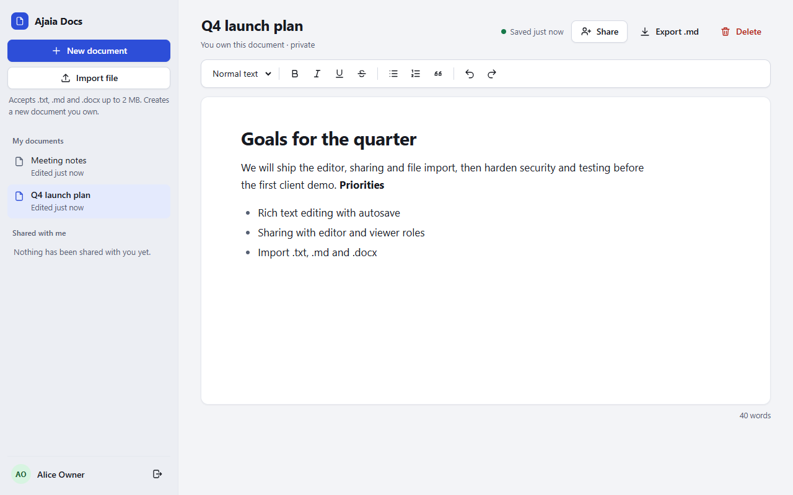
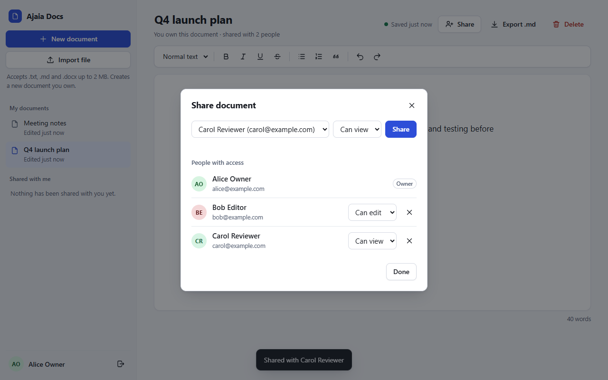
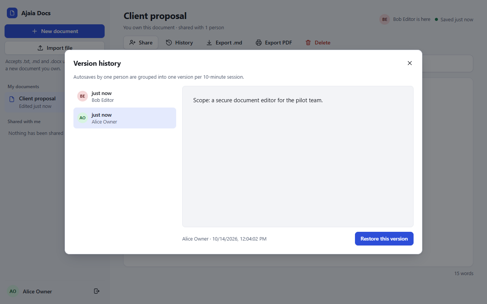
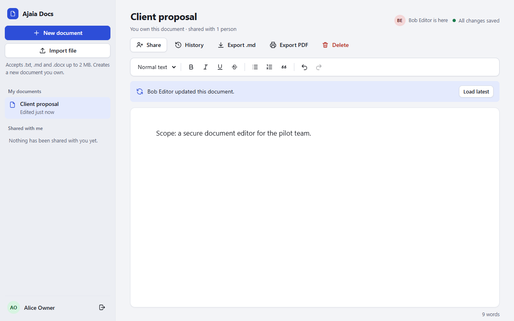
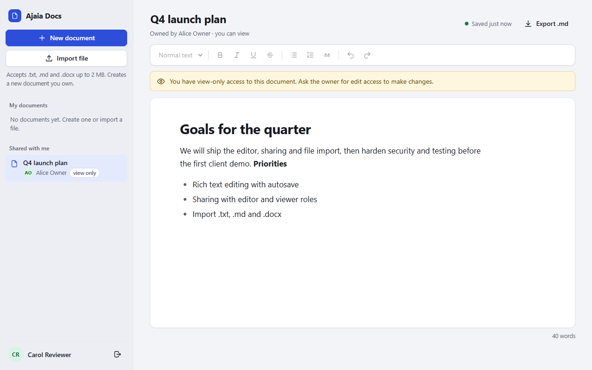

# Ajaia Docs

A lightweight collaborative document editor: write rich text, import files, share with teammates as **editors** or **viewers**, see who else is in a document, and roll back to any earlier version.

Built for the Ajaia AI-Native Full Stack Developer assessment as one focused, tested product slice, not a Google Docs clone.

| | |
|---|---|
| **Live demo** | **https://ajaia-docs-three-pi.vercel.app** (the first request after a few idle minutes can take 1–3 s while the free database wakes up) |
| **Walkthrough video** | see [`VIDEO_URL.txt`](VIDEO_URL.txt) |
| **Test accounts** | no passwords. Pick **Alice**, **Bob** or **Carol** on the sign-in screen |



---

## Contents
- [Features](#features)
- [Try it in 2 minutes](#try-it-in-2-minutes)
- [Run locally](#run-locally)
- [Tests](#tests)
- [Architecture](#architecture)
- [API reference](#api-reference)
- [Security](#security)
- [Configuration](#configuration)
- [Deploy](#deploy)
- [Scope: what's in, what's out](#scope-whats-in-whats-out)
- [Project layout](#project-layout)
- [More documentation](#more-documentation)

---

## Features

**Core (required by the brief)**

| Area | What you can do |
|---|---|
| Documents | Create, rename, edit and delete. Autosave about 0.8 s after you stop typing. Reopen with formatting intact |
| Rich text | Headings H1–H3, **bold**, *italic*, <u>underline</u>, ~~strikethrough~~, bulleted and numbered lists, quotes, undo/redo, Markdown shortcuts (`# `, `- `, `1. `) |
| File import | `.txt`, `.md` and `.docx` (max 2 MB) become a new editable document. Limits are shown next to the button |
| Sharing | The owner grants **Can edit** or **Can view**, changes a person's access in place, or removes it. "My documents" and "Shared with me" are separate lists |
| Persistence | Postgres. Documents, formatting, sharing and history survive refreshes and redeploys |

**Stretch items (all optional in the brief)**

| Stretch item | Built as |
|---|---|
| Real-time collaboration indicators | Avatars of who else has the document open, plus a "Bob updated this document. Load latest" notice |
| Document version history | Browse earlier versions with author and time, preview them, restore any one (owners and editors). It doubles as an audit trail (who changed what, and when), which regulated teams need |
| Export to PDF or Markdown | **Export .md** downloads Markdown; **Export PDF** prints only the document through the browser's Save as PDF |
| Role-based permissions beyond basic access | Owner / editor / viewer, enforced on every API route, with in-place role changes |
| Commenting or suggestion mode | Not built (see [Scope](#scope-whats-in-whats-out)) |

**Product quality:** dark mode that follows the system, mobile layout with a slide-out menu, keyboard-only use, screen-reader labels and live save status, clear empty states and error messages.

| Share dialog | Version history |
|---|---|
|  |  |

| Who else is here | Viewer (read-only) |
|---|---|
|  |  |

---

## Try it in 2 minutes

| # | Do this | You should see |
|---|---|---|
| 1 | Sign in as **Alice Owner** → **New document**, type a title, press Enter, write | "All changes saved" |
| 2 | Use the toolbar: Heading 1, bold, a bulleted list. **Refresh** | Everything is still there |
| 3 | **Share** → Bob *Can edit*, Carol *Can view* | Both listed under "People with access" |
| 4 | Open the same document in a second browser (or private window) as **Bob** and edit | Alice sees "Bob Editor is here", then "Bob Editor updated this document" |
| 5 | **Switch user** (icon next to your name) → **Carol** | Read-only banner, disabled toolbar. Her direct API write returns 403 |
| 6 | As Alice: **History** → pick the older version → **Restore this version** | The earlier text is back, and the restore is itself a version |
| 7 | **Import file** with a `.docx`, `.md` or `.txt` | A new document you own |
| 8 | **Export .md** / **Export PDF** | Markdown file / print dialog with only the document |

A longer manual test script (14 steps, including offline and keyboard checks) is in [`docs/TESTING.md`](docs/TESTING.md).

---

## Run locally

**Requirements:** Node.js **22.12 or newer**. Nothing else: without a `DATABASE_URL`, the app runs an embedded Postgres (PGlite) stored in `./data/`.

```bash
git clone https://github.com/Danish-Ahmed-Head/ajaia-docs.git
cd ajaia-docs
npm install
npm run dev          # builds the frontend, then serves http://localhost:3000
```

| Command | What it does |
|---|---|
| `npm run dev` | Build the frontend and start the server |
| `npm start` | Start the server (expects a built `dist/`) |
| `npm run build` | Build the frontend with Vite into `dist/` |
| `npm test` | 40 API tests against in-memory Postgres |
| `npm run test:e2e` | 18 browser tests (Playwright, uses your installed Google Chrome) |
| `npm run lint` | ESLint |
| `npm run check` | Lint + API tests + build: the gate run before every commit |

To reset local data, stop the server and delete `./data/`. The three demo users are re-created on start.

No Google Chrome? Run `npx playwright install chromium`, then `PW_CHANNEL=chromium npm run test:e2e`.

---

## Tests

```bash
npm run check       # ESLint + 40 API tests + production build
npm run test:e2e    # 18 end-to-end tests in real Chrome
```

| Suite | Tests | Covers |
|---|---|---|
| `test/api.test.js` | 7 | Create, rename, edit, reopen; formatting kept and scripts stripped; validation; error shapes; delete cascades |
| `test/sharing.test.js` | 4 | Who sees the share list; changing roles; invalid shares; revoking access |
| `test/security.test.js` | 5 | Forged and tampered session cookies; cookie flags; CSP and security headers; non-JSON writes refused; login rate limit |
| `test/convert.test.js` | 5 | `.txt` escaping, Markdown subset, a real generated `.docx`, unsupported and corrupt files |
| `test/versions.test.js` | 5 | Version grouping per author and session; restore; viewer and stranger access; cross-document version IDs refused; presence |
| `test/review-fixes.test.js` | 8 | Regression tests for the independent code review: id ranges, link rel, malformed uploads, zip bombs, history cap, production config, start-up failure, restart idempotency |
| `test/vercel.test.js` | 4 | The exact bundle Vercel deploys: serves the API, loads with no `node_modules`, fails cleanly without secrets, correct routes and headers |
| `e2e/app.spec.js` | 14 | Owner flow with reload, three-user sharing, import, export (Markdown and PDF), version restore, two-browser presence, keyboard-only use, focus races, expired session |

Every single-browser end-to-end test also **fails on any browser console error**. As a check that the tests can actually catch bugs, four deliberate security bugs were injected into the server one at a time (viewers allowed to edit, non-owners allowed to share, sanitising removed, session signature check removed). The suite failed every time. Details: [`docs/TESTING.md`](docs/TESTING.md).

---

## Architecture

```
Browser ─ Vite-built vanilla JS + Tiptap 3 editor
   │  fetch() JSON · signed httpOnly session cookie · 10 s presence ping
   ▼
Express 5 API
   ├─ loadDoc(): the single access gate → owner | editor | viewer, else 403/404
   ├─ sanitize-html allow-list on every write
   ├─ version history (one version per author per 10-min session)
   └─ helmet (CSP), rate limits, JSON/multipart-only writes
   ▼
Postgres ─ Neon in production · PGlite (same SQL) for local dev and tests
```

| Layer | Choice | Why |
|---|---|---|
| Editor | Tiptap 3 (ProseMirror) | Schema-enforced, always well-formed HTML; covers every required format; standard path to real-time collaboration (Yjs) |
| Frontend | Vanilla JS bundled by Vite 8 | One screen doesn't need a framework; fast to load and easy to review |
| API | Express 5 | Small and familiar; async errors reach the error handler natively |
| Database | Postgres via `pg` (Neon) / PGlite | Durable on a free host; tests run the production SQL dialect with zero setup |
| Upload | multer 2 + mammoth | CVE-patched upload handling; `.docx` is what teams actually have |

**Data model**

```
users(id, name, email)
documents(id, title, content, owner_id → users, created_at, updated_at)
shares(doc_id → documents, user_id → users, role: viewer | editor)        PK (doc_id, user_id)
document_versions(id, doc_id → documents, title, content, author_id, note, started_at, saved_at)
```

Deleting a document cascades to its shares and versions. Content is stored as sanitised HTML.

**Access rules** (enforced on the server; the UI only mirrors them)

| Action | Owner | Editor | Viewer | No access |
|---|:-:|:-:|:-:|:-:|
| Read document and history, see presence | ✓ | ✓ | ✓ | 403 |
| Edit, restore a version | ✓ | ✓ | 403 | 403 |
| Share, change roles, unshare, delete | ✓ | 403 | 403 | 403 |

Full design notes: [`ARCHITECTURE.md`](ARCHITECTURE.md). Every technology choice, with the options considered and the evidence: [`docs/DECISIONS.md`](docs/DECISIONS.md).

---

## API reference

All endpoints are under `/api`, return JSON, and use `{ "error": "message" }` for errors. Writes accept only `application/json` (or `multipart/form-data` for upload).

| Method | Path | Who | Purpose |
|---|---|---|---|
| GET | `/health` | anyone | Liveness check |
| GET | `/users` | anyone | Demo users for the sign-in screen |
| POST | `/login` | anyone | `{ email }` → sets the session cookie |
| POST | `/logout` | anyone | Clears the session cookie |
| GET | `/me` | anyone | Current user or `null` |
| GET | `/docs` | signed in | `{ owned, shared }` lists |
| POST | `/docs` | signed in | `{ title? }` → `{ id }` |
| GET | `/docs/:id` | any role | Document, your role, and the share list (owner only) |
| PUT | `/docs/:id` | owner, editor | `{ title?, content? }` → `{ updated_at }` |
| DELETE | `/docs/:id` | owner | Delete the document (and its shares and versions) |
| POST | `/docs/:id/share` | owner | `{ email, role }`: add a person or change their role |
| DELETE | `/docs/:id/share/:userId` | owner | Remove access |
| GET | `/docs/:id/versions` | any role | Latest 50 versions, newest first |
| GET | `/docs/:id/versions/:vid` | any role | One version with its content |
| POST | `/docs/:id/versions/:vid/restore` | owner, editor | Restore a version (recorded as a new version) |
| POST | `/docs/:id/presence` | any role | Heartbeat → `{ others, updated_at, last_editor }` |
| DELETE | `/docs/:id/presence` | any role | Leave the document |
| POST | `/upload` | signed in | Multipart field `file` (.txt/.md/.docx, ≤ 2 MB) → `{ id }` |
| GET | `/upload/supported` | anyone | Supported extensions and size limit |

Common status codes: `400` invalid input · `401` not signed in · `403` not allowed · `404` not found (or not yours) · `413` too large · `415` wrong type · `422` unreadable `.docx` · `429` rate limited.

---

## Security

| Control | Detail |
|---|---|
| Sessions | HMAC-SHA256 signed cookie, compared in constant time; `HttpOnly`, `SameSite=Lax`, `Secure` in production. The server refuses to start in production without `SESSION_SECRET` |
| Authorisation | One server-side gate (`loadDoc`) on every document route; version IDs are checked against their document |
| Stored content | `sanitize-html` allow-list on every write and import: no scripts, event handlers or unknown tags |
| Headers | `helmet` with a strict Content-Security-Policy, `nosniff`, frame protection; `X-Powered-By` removed |
| Abuse | Rate limits on failed logins, uploads, and overall API traffic |
| Cross-site writes | Writes must be JSON or multipart, which blocks form-encoded posts from other sites (on top of `SameSite`) |
| Uploads | Kept in memory, 2 MB and one file per request, extension allow-list; corrupt files fail cleanly |
| Secrets | None in the repo; `DATABASE_URL` and `SESSION_SECRET` live in the host's environment settings |

**Known limitation, by design:** sign-in is simulated, as the brief allows, so anyone with the URL can act as a demo user. Don't put real data in the demo.

---

## Configuration

| Variable | Default | Purpose |
|---|---|---|
| `DATABASE_URL` | unset → PGlite in `./data/pglite` | Postgres connection string (production: Neon) |
| `SESSION_SECRET` | random per start (dev only) | At least 32 characters. **Required** when `NODE_ENV=production` |
| `NODE_ENV` | unset | `production` enables `Secure` cookies and trusts the host's proxy |
| `PORT` | `3000` | HTTP port |
| `DB_IN_MEMORY` | unset | `1` uses a throwaway in-memory database (used by the E2E tests) |

---

## Deploy

**Live setup (free, no card): Vercel + Neon Postgres.** [`vercel.json`](vercel.json) builds the frontend to `dist/` (served from Vercel's CDN with security headers) and runs the Express API as one Vercel Function ([`server/vercel.js`](server/vercel.js), bundled by [`scripts/build-vercel.mjs`](scripts/build-vercel.mjs)) in Portland, next to the Neon database in Oregon.

1. Create a free Neon project (region **AWS US West 2, Oregon**) and copy its **pooled** connection string.
2. Import the repo at https://vercel.com/new and keep the settings from `vercel.json`.
3. Add two environment variables:
   - `DATABASE_URL`: the Neon string
   - `SESSION_SECRET`: 64 random hex characters, generated with `node -e "console.log(require('crypto').randomBytes(32).toString('hex'))"`
4. Deploy. Then check `/api/health` returns `{"ok":true,"db":"postgres"}`. Tables and demo users are created on first request.

**Alternatives:**
- Render: [`render.yaml`](render.yaml) included. It's free, but Render may ask for card verification.
- Any container host: [`Dockerfile`](Dockerfile) included.

All options are compared in [`docs/DEPLOYMENT.md`](docs/DEPLOYMENT.md).

---

## Scope: what's in, what's out

The brief asked for deliberate scope cuts. These are the ones I made and why:

| Not built | Why | How I'd add it |
|---|---|---|
| Real authentication | The brief allows mocked users; the time went to sharing and access control instead | Magic-link or OAuth sign-in with server-side sessions; invite-by-email |
| Simultaneous co-editing | A half-working version would be worse than none. Presence + "Load latest" covers awareness honestly | Yjs + Tiptap Collaboration over WebSockets |
| Comments / suggestion mode | Needs anchored ranges that survive edits; too big to do well in the timebox | Tiptap comment marks + a `comments` table |
| Conflict merging | Saves are last-write-wins; the update notice makes this visible | Send `updated_at` with each save and return 409 on conflicts |

**Known limitations:**
- Presence is kept in server memory. On Vercel, requests can land on different function instances, so an avatar can occasionally be missing. Redis or WebSockets would make it exact.
- Neon's free database sleeps after 5 idle minutes, so the first request after a pause can take a second or two longer.
- Rate limits are also per function instance on Vercel, so they are a best-effort guard, not a hard global limit.
- `npm audit` reports 3 moderate findings in mammoth's command-line dependency (`argparse` → `sprintf-js`). This app only calls mammoth's library API, so that code path isn't reachable.

---

## Project layout

```
server/
  app.js          Express API: auth, documents, access gate, sharing, versions, presence, upload, errors
  db.js           Postgres schema + demo users; pg (production) or PGlite (dev/tests) behind one query() interface
  session.js      Signed, stateless session cookie
  convert.js      .txt / .md / .docx → HTML
  index.js        Startup and configuration
src/
  index.html      App shell, dialogs, icon set
  app.js          Frontend: editor, autosave, sharing, history, presence, export
  style.css       Design tokens, light/dark themes, responsive and print styles
test/             API tests (node:test) against in-memory Postgres
e2e/              Browser tests (Playwright)
docs/             Decisions, SDLC record, testing guide, deployment options, plan
screenshots/      Images used in this README
```

---

## More documentation

| Document | What's in it |
|---|---|
| [`ARCHITECTURE.md`](ARCHITECTURE.md) | Architecture note: priorities, access model, trade-offs |
| [`AI_WORKFLOW.md`](AI_WORKFLOW.md) | How AI tools were used, what was changed or rejected, how output was verified |
| [`docs/DECISIONS.md`](docs/DECISIONS.md) | Every technology choice with options, evidence and accept/reject reasons |
| [`docs/SDLC.md`](docs/SDLC.md) | Process record, phases, and the defect log |
| [`docs/TESTING.md`](docs/TESTING.md) | Test strategy, the mutation check, and a manual test script |
| [`docs/DEPLOYMENT.md`](docs/DEPLOYMENT.md) | Hosting options compared and step-by-step deployment |
| [`SUBMISSION.md`](SUBMISSION.md) | What's included in the submission |
| [`docs/ieee/`](docs/ieee/00-INDEX.md) | Phase documents structured after IEEE / ISO/IEC/IEEE standards: project plan (16326), requirements with use cases (29148), design (1016), test documentation (29119-3). Includes the process mind map, workflow, use-case, sequence, ER, state and Gantt diagrams |
| [`docs/CODE_WALKTHROUGH.md`](docs/CODE_WALKTHROUGH.md) | Every file and library function explained |

---

**Author:** Danish Ahmed · [github.com/Danish-Ahmed-Head](https://github.com/Danish-Ahmed-Head) · [danish-ahmed-head.github.io](https://danish-ahmed-head.github.io)
