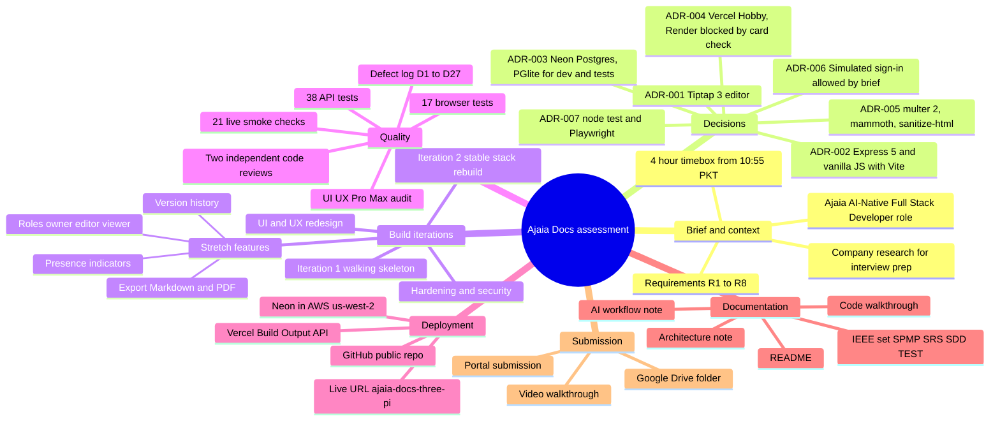
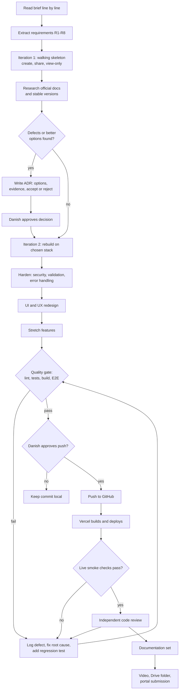
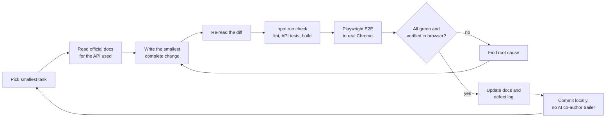
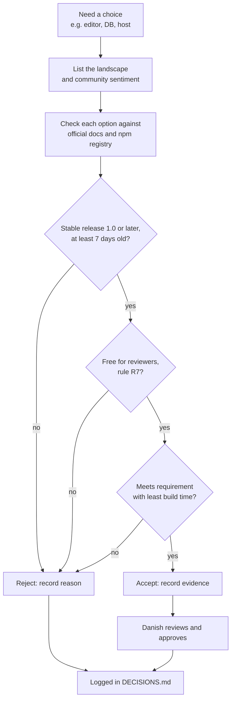
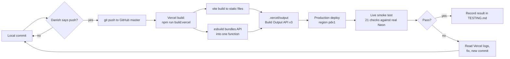
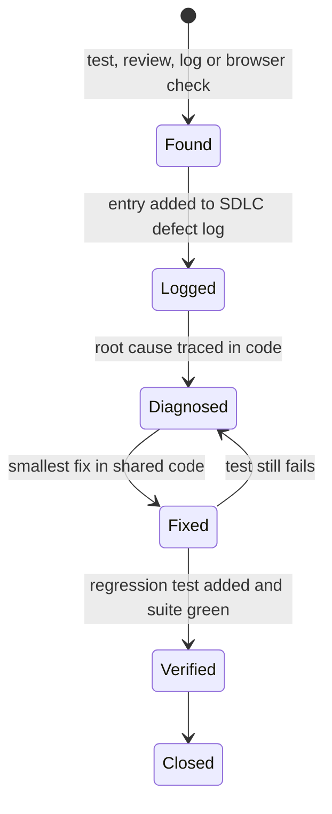

# Ajaia Docs: engineering documentation set

| | |
|---|---|
| Document ID | AJD-IDX-001 |
| Version | 1.0 |
| Date | 2026-10-14 |
| Author | Danish Ahmed |
| Status | Final for submission |

This folder holds one document per lifecycle phase. Each one is **structured after** the IEEE / ISO/IEC/IEEE standard for that phase. They follow the standards' outlines and content items; they are not certified as compliant. All diagrams are Mermaid, so they render directly on GitHub.

## 1. Document map

| Phase | Document | Structured after | What it answers |
|---|---|---|---|
| Lifecycle (all phases) | this index | ISO/IEC/IEEE 12207:2017, software life cycle processes | How the whole job ran, end to end |
| Planning and control | [01-SPMP.md](01-SPMP.md) | ISO/IEC/IEEE 16326:2019, project management (successor of IEEE 1058) and IEEE 828-2012, configuration management | Lifecycle model, schedule, roles, risks, change control |
| Requirements | [02-SRS.md](02-SRS.md) | ISO/IEC/IEEE 29148:2018, requirements engineering (successor of IEEE 830) | What the system must do; use cases; traceability |
| Design | [03-SDD.md](03-SDD.md) | IEEE 1016-2009, software design descriptions | How it is built: context, components, data, interactions, deployment |
| Testing, V&V | [04-TEST.md](04-TEST.md) | ISO/IEC/IEEE 29119-3:2021, test documentation (successor of IEEE 829), and IEEE 1012-2016, V&V | How it was proven: plan, cases, defects, results |
| Decisions | [../DECISIONS.md](../DECISIONS.md) | ADR format | Every technology choice with options, evidence, accept/reject |
| Process record | [../SDLC.md](../SDLC.md) | n/a | Who/when/what/why per phase, defect log D1–D27 |
| Code explanation | [../CODE_WALKTHROUGH.md](../CODE_WALKTHROUGH.md) | n/a | Every file and library function, line by line |

## 2. Mind map of the whole process

## 3. End-to-end workflow

## 4. Development loop used for every task

Each task was kept small and went round this loop until it passed. Nothing was called done without the check command's output.

## 5. Decision workflow (how each ADR was made)

## 6. Deployment and release workflow

## 7. Defect workflow

## 8. Timeline

```mermaid
gantt
  title Assessment day 2026-10-14, PKT
  dateFormat HH:mm
  axisFormat %H:%M
  section Analysis
  Read brief, requirements R1-R8        :a1, 10:55, 5m
  section Build
  Iteration 1 walking skeleton          :b1, 11:00, 13m
  Research and ADR-001 to 007           :b2, 11:13, 11m
  Iteration 2 stable stack              :b3, 11:17, 7m
  Hardening, security, tests            :b4, 11:24, 16m
  UI and UX redesign                    :b5, 11:43, 15m
  Stretch features                      :b6, 11:58, 16m
  section Deploy
  Render blocked, switch to Vercel      :d1, 12:14, 14m
  Fix Vercel 500s, go live, smoke 21/21 :d2, 12:28, 13m
  section Quality
  Independent review, 16 fixes          :q1, 12:41, 24m
  UX pass and Pro Max audit             :q2, 13:05, 34m
  section Documentation
  IEEE documentation set                :doc1, 13:39, 30m
  section Submission
  Video, Drive, portal by Danish        :s1, 14:10, 45m
```

Times come from the git log (`git log --date=format:%H:%M`) and the SDLC record. The last bar is planned, not done.
