# Software Project Management Plan (SPMP)

| | |
|---|---|
| Document ID | AJD-SPMP-001 |
| Version | 1.0 |
| Date | 2026-10-14 |
| Author | Danish Ahmed |
| Status | Final for submission |
| Structured after | ISO/IEC/IEEE 16326:2019 (successor of IEEE 1058). Section 7 follows IEEE 828-2012, configuration management |

## 1. Overview

**Project:** Ajaia Docs, a lightweight collaborative document editor: create, edit and share rich-text documents, import files, and keep everything persisted.
**Purpose:** a timed take-home assessment for Ajaia's AI-Native Full Stack Developer role.
**Timebox:** 4 hours, from about 10:55 PKT on 2026-10-14. The portal timer is authoritative.
**Deliverables required by the brief:** source code, README, live deployment, validation, at least one test, architecture note, AI workflow note, SUBMISSION.md, a 3–5 minute video, and a Google Drive folder.

## 2. Lifecycle model

**Chosen model:** time-boxed iterative and incremental, with every iteration ending in a working, tested build. The full rationale and rejected models (Waterfall, V-model, Spiral) are in [../SDLC.md](../SDLC.md).

```mermaid
flowchart LR
  R["Requirements<br/>R1-R8"] --> I1["Iteration 1<br/>walking skeleton"]
  I1 --> RS["Research<br/>ADR-001 to 007"]
  RS --> I2["Iteration 2<br/>stable stack"]
  I2 --> H["Hardening"]
  H --> UX["UI and UX"]
  UX --> ST["Stretch features"]
  ST --> DP["Deploy"]
  DP --> RV["Independent review"]
  RV --> UX2["UX pass and audit"]
  UX2 --> DOC["IEEE documentation"]
  DOC --> SUB["Submission"]
```

## 3. Organisation and responsibilities

| Activity | Danish Ahmed | Claude Code (AI pair) |
|---|---|---|
| Requirements interpretation | Approves | Drafts R1–R8 from the brief |
| Technology decisions (ADRs) | Approves each decision | Researches official docs, drafts options |
| Implementation | Reviews | Writes code in small tasks |
| Testing | Reviews results | Writes and runs tests, shows output |
| Push and deploy | **Decides every push** | Pushes only after an explicit "push" |
| Accounts: GitHub, Vercel, Neon | Owns and signs in | Guides; never enters credentials |
| Documentation | Edits; rewrites AI_WORKFLOW.md in his own voice | Drafts |
| Video, Drive folder, portal | Does them | Prepares checklists and text |

Standing rules: no "Co-Authored-By: Claude" trailer on commits; secrets never read or printed; ask before pushing, deploying or sending anything.

## 4. Work breakdown structure

```mermaid
flowchart TD
  P["Ajaia Docs"] --> W1["1 Requirements"]
  P --> W2["2 Design"]
  P --> W3["3 Implementation"]
  P --> W4["4 Verification"]
  P --> W5["5 Deployment"]
  P --> W6["6 Documentation"]
  P --> W7["7 Submission"]
  W1 --> W11["1.1 Brief analysis"]
  W1 --> W12["1.2 Company research"]
  W2 --> W21["2.1 ADRs"]
  W2 --> W22["2.2 Data model and API"]
  W3 --> W31["3.1 API and DB"]
  W3 --> W32["3.2 Editor frontend"]
  W3 --> W33["3.3 Import, sharing, versions, presence, export"]
  W4 --> W41["4.1 API tests"]
  W4 --> W42["4.2 E2E tests"]
  W4 --> W43["4.3 Reviews and audits"]
  W5 --> W51["5.1 Vercel and Neon"]
  W5 --> W52["5.2 Live smoke test"]
  W6 --> W61["6.1 README, architecture, AI workflow"]
  W6 --> W62["6.2 IEEE set and walkthrough"]
  W7 --> W71["7.1 Video"]
  W7 --> W72["7.2 Drive folder and portal"]
```

## 5. Schedule

The Gantt chart and actual times are in [00-INDEX.md](00-INDEX.md#8-timeline). Milestones from the git log:

| Time PKT | Milestone | Commit |
|---|---|---|
| 11:13 | Iteration 1 working | `bf723b8` |
| 11:24 | Iteration 2 on the stable stack, ADRs written | `13ff3c5` |
| 11:37 | Playwright E2E added | `ad9e30c` |
| 11:58 | UI/UX redesign | `174b306` |
| 12:08 | Stretch features | `157fbee` |
| 12:41 | Live on Vercel, smoke test 21/21 | `ac379a5` |
| 13:05 | 16 review defects fixed | `5f132f4` |
| 13:39 | UX audit fixes | `0ecb326` |

## 6. Risk management

| ID | Risk | Likelihood / Impact | Mitigation | Status |
|---|---|---|---|---|
| RK1 | Timebox overrun | High / High | Iterations always leave a submittable build; scope cuts written down | Managed |
| RK2 | Reviewer opens the link later and finds the data gone | Medium / High | Durable Neon Postgres instead of ephemeral disk (ADR-003) | Closed |
| RK3 | Host needs a payment card (Pakistan signup) | Occurred / High | Switched Render → Vercel Hobby at 12:20 (ADR-004) | Closed |
| RK4 | Vercel runtime can't load ESM-only dependency | Occurred / High | esbuild single-file bundle via Build Output API (D8) | Closed |
| RK5 | Vulnerable dependency versions | Medium / High | Latest stable, at least 7 days old; multer 2.4; sanitize-html kept on patched release | Closed |
| RK6 | Untrusted HTML or uploads | Medium / High | Server-side sanitise allow-list, size limits, zip-bomb check | Closed |
| RK7 | New schema/transaction code only tested on PGlite | Medium / Medium | Run live smoke test against Neon right after the next approved push | **Open until push** |
| RK8 | Presence and rate limits are in-memory, per instance | Low / Low | Documented as best-effort; Redis noted as next step | Accepted |

## 7. Configuration management (IEEE 828-2012)

| Item | Practice |
|---|---|
| Configuration items | Source (`server/`, `src/`, `scripts/`), tests (`test/`, `e2e/`), config (`package.json`, `package-lock.json`, `vercel.json`, `eslint.config.js`, `playwright.config.js`), docs |
| Identification | Git commit hash per baseline; app version 2.0.0 in `package.json` |
| Version control | Git, single `master` branch, public GitHub repo `Danish-Ahmed-Head/ajaia-docs` |
| Dependency baseline | Exact pinned versions plus lockfile; policy: newest stable release that is at least 7 days old |
| Change control | Each change is a small task → check passes → local commit → Danish approves the push |
| Status accounting | `docs/SDLC.md` defect log and phase table; DECISIONS.md change log |
| Release | Push to `master` → Vercel production build; verified by the live smoke test |
| Secrets | `DATABASE_URL` and `SESSION_SECRET` live only in Vercel environment variables; `.env` is gitignored |

## 8. Quality assurance gates

Every iteration had to pass these before a commit:
1. `npm run check`: ESLint, 40 API tests, Vite build.
2. `npx playwright test`: 18 browser tests, failing on any console error.
3. A browser check of the changed flow at desktop and phone widths.
4. No secrets in the diff.

After deployment, the live smoke test (21 checks) runs against the production URL.

## 9. Deliverables status

| Deliverable | Status |
|---|---|
| Source, README, architecture note, SUBMISSION.md | Done |
| Tests (40 API, 18 E2E) | Done, passing |
| Live deployment | Done; latest 3 local commits await push approval |
| AI workflow note | Drafted; Danish to rewrite in his own voice |
| IEEE documentation set | Done (this folder) |
| Video walkthrough | Danish |
| Google Drive folder and portal submission | Danish |
