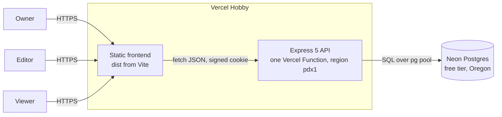
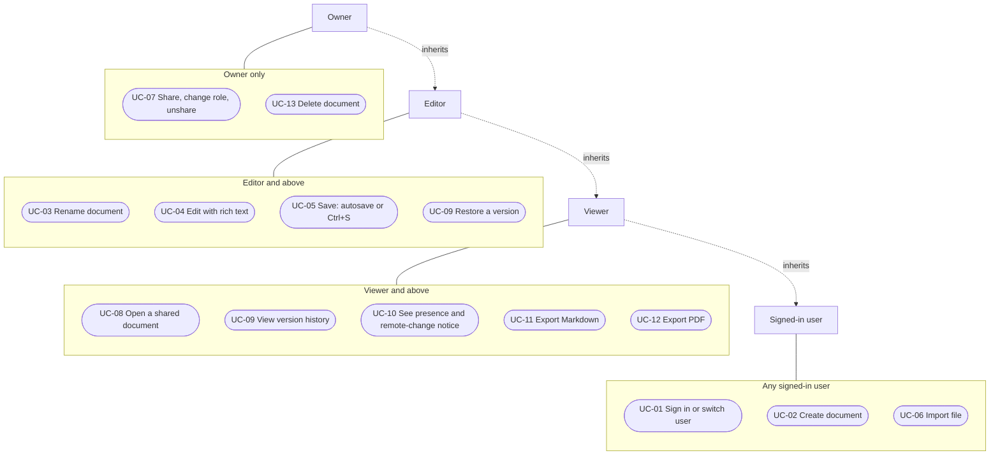
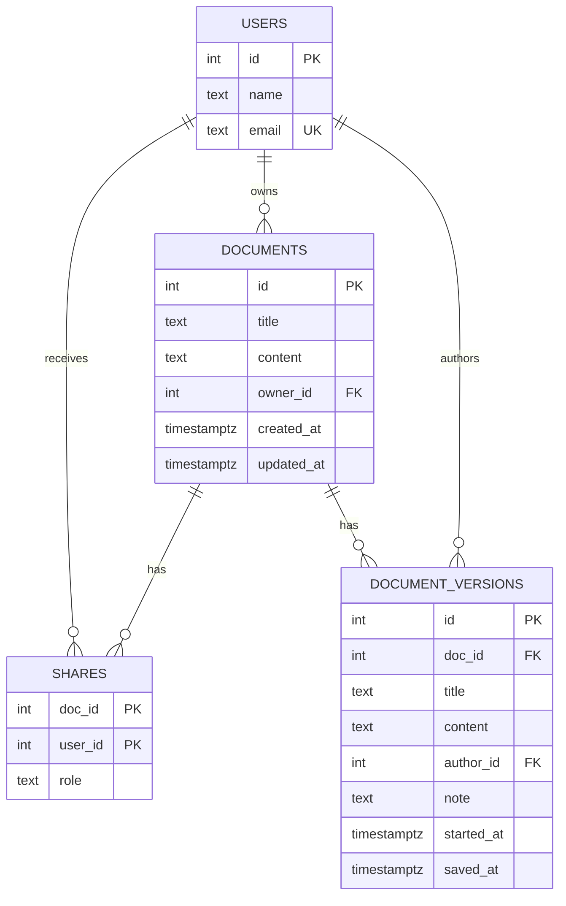

# Software Requirements Specification: Ajaia Docs

| Field | Value |
|---|---|
| Document ID | AJD-SRS-001 |
| Version | 1.0 |
| Date | 2026-10-14 |
| Author | Danish Ahmed |
| Status | Final for submission |
| Product | Ajaia Docs (https://ajaia-docs-three-pi.vercel.app) |

This document is structured after ISO/IEC/IEEE 29148:2018, *Systems and software engineering: Life cycle processes, Requirements engineering* (the standard that replaced IEEE Std 830-1998). It follows that standard's SRS content outline. It is not a claim of certified compliance.

Every requirement below describes behaviour that exists in the code at the time of writing. Numbers (limits, timers, caps) are copied from the source file named next to them.

---

## Contents

1. [Introduction](#1-introduction)
2. [Stakeholders and user classes](#2-stakeholders-and-user-classes)
3. [Overall description](#3-overall-description)
4. [Use cases](#4-use-cases)
5. [Functional requirements](#5-functional-requirements)
6. [Non-functional requirements](#6-non-functional-requirements)
7. [External interface requirements](#7-external-interface-requirements)
8. [Data requirements](#8-data-requirements)
9. [Requirements traceability matrix](#9-requirements-traceability-matrix)
10. [Out of scope](#10-out-of-scope)

---

## 1. Introduction

### 1.1 Purpose

This SRS states what Ajaia Docs does, under which constraints, and how each requirement is verified. It is written for the Ajaia reviewers of the "AI-Native Full Stack Developer" assessment and for any developer who continues the project.

### 1.2 Scope

Ajaia Docs is a lightweight collaborative document editor. A signed-in user can create, rename, edit and delete rich-text documents, import `.txt`, `.md` and `.docx` files as new documents, share a document with another user as an editor or a viewer, browse and restore earlier versions, see who else has the document open, and export a document as Markdown or as a PDF through the browser's print dialog.

The product is one tested slice built inside a timed assessment. It is not a Google Docs replacement: sign-in is simulated and there is no simultaneous co-editing (see section 10).

### 1.3 Product overview

| Layer | Implementation | Source |
|---|---|---|
| Frontend | Vanilla JavaScript bundled by Vite, Tiptap 3 editor (StarterKit) | `src/index.html`, `src/app.js`, `src/style.css` |
| API | Node.js 22 + Express 5 | `server/app.js` |
| Sessions | Stateless HMAC-SHA256 signed cookie | `server/session.js` |
| File conversion | `.txt` and `.md` converters, `mammoth` for `.docx` | `server/convert.js` |
| Persistence | Postgres: Neon via `pg` in production, PGlite (Postgres in WASM) for development and tests | `server/db.js` |
| Entry points | Long-running server (`server/index.js`); Vercel Function (`server/vercel.js`) | |

### 1.4 Definitions and acronyms

| Term | Meaning |
|---|---|
| Owner | The user who created or imported a document. Has full control |
| Editor | A user the owner shared the document with as "Can edit" |
| Viewer | A user the owner shared the document with as "Can view" (read-only) |
| Stranger | A signed-in user with no role on a given document |
| Version | A stored snapshot (title + content) in `document_versions` |
| Presence | The list of other users who currently have a document open |
| Autosave | The save that runs automatically after the user stops typing |
| ADR | Architecture Decision Record (`docs/DECISIONS.md`) |
| CSP | Content-Security-Policy HTTP header |
| E2E | End-to-end browser test (Playwright, `e2e/app.spec.js`) |
| PGlite | Embedded Postgres compiled to WASM, used locally and in tests |
| SRS | Software Requirements Specification |
| UC / FR / NFR | Use case / functional requirement / non-functional requirement |
| TTL | Time to live |

### 1.5 References

| ID | Reference |
|---|---|
| REF-1 | ISO/IEC/IEEE 29148:2018, Requirements engineering (this document is structured after it) |
| REF-2 | Ajaia assessment brief, requirements R1 to R8 as restated in `docs/DECISIONS.md` |
| REF-3 | `README.md`: features, API reference, security, scope |
| REF-4 | `ARCHITECTURE.md`: architecture note and trade-offs |
| REF-5 | `docs/DECISIONS.md`: ADR-001 to ADR-007 and change log |
| REF-6 | `docs/SDLC.md`: lifecycle record and defect log D1 to D27 |
| REF-7 | `docs/PLAN.md`: iteration 3 hardening plan |
| REF-8 | `docs/TESTING.md`: test strategy and manual test script |

---

## 2. Stakeholders and user classes

### 2.1 Stakeholders

| Stakeholder | Interest |
|---|---|
| Ajaia hiring reviewers | Evaluate the product, code quality, prioritisation and documentation within a few minutes, without paying for anything (brief R7) |
| Danish Ahmed (developer, product owner) | Delivers a working, deployed, tested slice inside the timebox |
| Future maintainers | Need clear requirements, tests and decision records to extend the product |

### 2.2 User classes

Roles are per document. The same person can be an owner of one document and a viewer of another.

| User class | Seeded demo user | Capabilities | Frequency |
|---|---|---|---|
| Owner | Alice Owner (`alice@example.com`) in the demo script | Everything: edit, rename, share, change roles, unshare, restore versions, delete | Primary user |
| Editor | Bob Editor (`bob@example.com`) in the demo script | Read, edit, rename, view history, restore versions, see presence | Regular |
| Viewer | Carol Reviewer (`carol@example.com`) in the demo script | Read, view history (no restore), see presence, export | Occasional |
| Stranger | Any signed-in user without a share | Nothing on that document (403) | n/a |
| Assessment reviewer | Uses all three seeded users, often in two browsers | Exercises every role; may call the API directly | One-off, time-limited |

The demo hints on the sign-in screen (`DEMO_ROLE_HINT` in `src/app.js`) describe the intended demo roles. The roles themselves are not fixed to these people: any seeded user can own documents.

---

## 3. Overall description

### 3.1 Product perspective

Ajaia Docs is a self-contained web application. It has no external integrations apart from its database and its host.

Alternative deployments exist in the repository (`Dockerfile`, `render.yaml`) but are not the live setup.

### 3.2 Product functions (summary)

| Function group | Summary |
|---|---|
| Identity | Pick one of three seeded users; switch user; session cookie |
| Documents | Create, rename, edit rich text, autosave, Ctrl/Cmd+S, reopen, delete |
| Lists | "My documents" and "Shared with me", newest first |
| Import | `.txt`, `.md`, `.docx` up to 2 MB, via file picker or drag-and-drop |
| Sharing | Owner grants "Can edit" or "Can view", changes the role in place, removes access |
| Version history | Grouped versions, preview, restore (recorded as a new version) |
| Awareness | Presence avatars and a "someone updated this document" notice with "Load latest" |
| Export | Markdown file download; PDF through the browser's print dialog |

### 3.3 Constraints

| ID | Constraint | Source |
|---|---|---|
| C-1 | Timebox: assessment started about 10:55 PKT, hard stop about 14:55 PKT on 2026-10-14. The brief allows 4 to 6 hours and asks for depth over breadth | `docs/DECISIONS.md` (R8, header) |
| C-2 | Reviewers must not have to pay; only free hosting and database tiers and MIT/open-source editor features | R7, ADR-001, ADR-004 |
| C-3 | Hosting moved from Render to Vercel Hobby at 12:20 PKT because Render asked for card verification on a signup from Pakistan; Vercel Hobby signup has no card field | ADR-004, change log |
| C-4 | Persistence must survive reviewer visits on a free host, so a hosted Postgres (Neon free tier) is used instead of SQLite on an ephemeral filesystem | ADR-003 |
| C-5 | Vercel's function loader cannot `require()` ESM-only packages, so the API is bundled into one self-contained ES module | `server/vercel.js`, defect D8 |
| C-6 | Authentication may be mocked (allowed by the brief) | R4, ADR-006 |
| C-7 | Node.js 22.12 or newer (Vite 8 requirement) | README, ADR-002 |

### 3.4 Assumptions and dependencies

| ID | Assumption or dependency |
|---|---|
| A-1 | Users run a current desktop or mobile browser with JavaScript, `fetch`, `<dialog>` and `inert` support |
| A-2 | Neon's free compute suspends after 5 idle minutes; the first request afterwards can take 1 to 3 seconds (README) |
| A-3 | On Vercel, requests may land on different function instances. In-memory presence and rate-limit counters are therefore per instance and best effort (README "Known limitations") |
| A-4 | Demo data is not confidential. Anyone with the URL can act as a demo user |
| A-5 | Runtime dependencies: `express`, `helmet`, `express-rate-limit`, `multer`, `sanitize-html`, `mammoth`, `pg`, `@electric-sql/pglite`, `@tiptap/core`, `@tiptap/starter-kit` |
| A-6 | Environment variables `DATABASE_URL` and `SESSION_SECRET` are set in production (`server/index.js`, `server/vercel.js`) |

---

## 4. Use cases

### 4.1 Use case diagram

Roles are per document. The diagram uses UML actor generalisation (dotted "inherits" arrows): an Editor can do everything a Viewer can, an Owner everything an Editor can, and every role is a Signed-in user. So each use case is drawn once, at the lowest role that may perform it. Editors and Viewers reach a document only through a share created by its Owner.

Viewers reach UC-09 for viewing only; restore is refused for them (FR-22). Creating or importing a document makes that user its Owner.

### 4.2 Use case specifications

#### UC-01 Sign in or switch user

| Field | Content |
|---|---|
| Primary actor | Any user |
| Preconditions | The app is loaded. No valid session, or the user clicks "Switch user" |
| Main flow | 1. The sign-in screen lists the seeded users from `GET /api/users`, each with a role hint. 2. The user clicks a name. 3. The client sends `POST /api/login` with that email. 4. The server sets a signed `sid` cookie and returns the user. 5. The app loads the document lists |
| Alternate flows | A1. Switch user: the client first flushes any unsaved change, sends `DELETE .../presence`, calls `POST /api/logout`, closes the open document completely, and shows the sign-in screen. A2. If a pending save cannot be completed, the user is asked to confirm leaving |
| Exception flows | E1. Unknown email: 404 "Unknown user". E2. More than 20 failed logins from one IP in 15 minutes: 429. E3. A later API call returns 401 (expired or tampered cookie): the app closes the document, shows "Your session ended. Please sign in again." and returns to sign-in |
| Postconditions | A valid session for the chosen user; no data of the previous user is visible |
| Related requirements | FR-01, FR-02, FR-03, NFR-SEC-01, NFR-SEC-05 |

#### UC-02 Create document

| Field | Content |
|---|---|
| Primary actor | Signed-in user (becomes Owner) |
| Preconditions | Signed in |
| Main flow | 1. User clicks "New document" (sidebar or empty state). 2. The current document view is locked (`inert`) so early keystrokes cannot land in it. 3. Client sends `POST /api/docs` with title "Untitled document". 4. Server returns 201 with the new id. 5. The app opens the document and selects the title text so the user can type a name |
| Alternate flows | A1. Pressing Enter in the title moves focus into the editor body |
| Exception flows | E1. API error: the lock is released and the error is shown as a toast |
| Postconditions | A new, empty document owned by the user appears at the top of "My documents" |
| Related requirements | FR-04, FR-11 |

#### UC-03 Rename document

| Field | Content |
|---|---|
| Primary actor | Owner or Editor |
| Preconditions | Document open with role owner or editor |
| Main flow | 1. User edits the title field. 2. Autosave (UC-05) sends the trimmed title. 3. The sidebar list and browser tab title update |
| Alternate flows | none |
| Exception flows | E1. Empty title: the client shows "Add a title to save" and does not save; the server would return 400 "Title cannot be empty". E2. Title over 200 characters: 400 |
| Postconditions | The new title is stored and shown in all lists |
| Related requirements | FR-05, FR-07 |

#### UC-04 Edit with rich text

| Field | Content |
|---|---|
| Primary actor | Owner or Editor |
| Preconditions | Document open with role owner or editor |
| Main flow | 1. User types in the editor. 2. User applies formatting from the toolbar (text style select: Paragraph, Heading 1 to 3; bold; italic; underline; strikethrough; bulleted list; numbered list; quote; undo; redo) or with Markdown shortcuts such as `# `, `- `, `1. `. 3. The toolbar reflects the active marks. 4. Every change schedules an autosave |
| Alternate flows | A1. Keyboard users move through the text style select with arrow keys; focus returns to the document on Enter or Escape |
| Exception flows | E1. Viewer: editor is not editable, toolbar is disabled, a read-only banner is shown |
| Postconditions | Formatted content is saved as sanitised HTML |
| Related requirements | FR-06, FR-07, FR-17, NFR-SEC-02 |

#### UC-05 Save: autosave or Ctrl+S

| Field | Content |
|---|---|
| Primary actor | Owner or Editor |
| Preconditions | Document open with unsaved changes |
| Main flow | 1. Status shows "Unsaved changes...". 2. 800 ms after the last change, the client sends `PUT /api/docs/:id` with title and HTML. 3. Status shows "Saving..." then "All changes saved". 4. The server stores the sanitised content and records a version in the same transaction |
| Alternate flows | A1. Ctrl+S or Cmd+S saves immediately instead of opening the browser's "Save page" dialog; if nothing is unsaved, the toast "All changes are saved automatically" appears. A2. Closing the tab with unsaved changes sends a `keepalive` save and triggers the browser's leave warning |
| Exception flows | E1. Network error, 429 or 5xx: status shows "Not saved: ..." and the save retries after 5 seconds. E2. Validation error (400 or 413): the status shows the error and the client waits for the next edit. E3. 403 or 404: the user's access changed; see FR-25 |
| Postconditions | The server copy matches the editor; history is updated (FR-20) |
| Related requirements | FR-07, FR-08, FR-09, FR-10, FR-20, NFR-REL-01, NFR-REL-02 |

#### UC-06 Import file

| Field | Content |
|---|---|
| Primary actor | Signed-in user (becomes Owner of the new document) |
| Preconditions | Signed in |
| Main flow | 1. User clicks "Import file" (the button's tooltip states "Supported: .txt, .md, .docx (max 2 MB)") and picks a file. 2. The client checks the extension and size. 3. The client sends `POST /api/upload` as multipart field `file`. 4. The server converts the file to HTML, sanitises it, creates the document and its first version with the note "Imported from <file name>" in one transaction. 5. The app opens the new document and shows "Imported "<name>" as a new document" |
| Alternate flows | A1. Drag and drop: dropping a file anywhere on the app shows a drop overlay and imports it the same way |
| Exception flows | E1. Unsupported extension: client toast "Unsupported file. Use .txt, .md or .docx"; the server returns 415 if called directly. E2. Over 2 MB: client toast; server 413 "File too large (max 2 MB)". E3. Corrupt `.docx`: 422. E4. `.docx` expanding to more than 20 MB: 413. E5. Malformed multipart: 400. E6. More than 30 uploads per 10 minutes from one IP: 429 |
| Postconditions | A new editable document titled after the file name (extension removed) |
| Related requirements | FR-12, FR-13, FR-14, NFR-SEC-04, NFR-SEC-06 |

#### UC-07 Share, change role, unshare

| Field | Content |
|---|---|
| Primary actor | Owner |
| Preconditions | Document open with role owner |
| Main flow | 1. Owner clicks "Share". 2. The dialog lists the other users and "People with access". 3. Owner picks a person and "Can edit" or "Can view" and adds them (`POST /api/docs/:id/share`). 4. The person appears in the list with a role selector and a remove button |
| Alternate flows | A1. Change role: the owner changes the selector; the same endpoint updates the existing share instead of duplicating it. A2. Unshare: the owner clicks remove (`DELETE /api/docs/:id/share/:userId`); access ends immediately |
| Exception flows | E1. Non-owner calls share or unshare: 403. E2. Role other than viewer or editor: 400. E3. Unknown email: 404. E4. Sharing with the owner: 400 "The owner already has full access" |
| Postconditions | The share is stored; the document appears in the recipient's "Shared with me" list with the role pill "can edit" or "view only" |
| Related requirements | FR-15, FR-16, FR-19 |

#### UC-08 Open a shared document

| Field | Content |
|---|---|
| Primary actor | Editor or Viewer |
| Preconditions | The owner has shared the document with the user |
| Main flow | 1. User opens the document from "Shared with me". 2. The header shows "Owned by <name>, you can edit" or "you can view". 3. Editors edit as in UC-04. 4. Viewers see a read-only banner, a read-only title and a disabled toolbar; Share and Delete are hidden |
| Alternate flows | A1. The owner changes the user's role or removes access while the document is open: the next save or presence call gets 403 or 404, the app shows "Your access to this document changed." and reloads the document with the new role |
| Exception flows | E1. A viewer's direct `PUT` returns 403 "View-only access: you cannot edit this document". E2. A stranger gets 403; an unknown id gets 404 |
| Postconditions | The user sees the document with exactly the rights of their role |
| Related requirements | FR-11, FR-17, FR-18, FR-25 |

#### UC-09 View or restore version history

| Field | Content |
|---|---|
| Primary actor | Owner, Editor (restore); Viewer (view only) |
| Preconditions | Document open |
| Main flow | 1. User clicks "History"; pending changes are saved first. 2. The dialog lists up to 50 latest versions with author and relative time, and notes such as "Imported from ..." or "Restored the version from an earlier version". 3. Selecting a version shows its content and author/time; the newest is marked "This is the current version". 4. Owner or editor clicks "Restore this version". 5. The server writes the old title and content back and records the restore as a new version. 6. The document reloads and a toast confirms the restore |
| Alternate flows | A1. No versions yet: "No versions yet. They appear after the first edit." |
| Exception flows | E1. Viewer: the restore button is hidden; a direct call returns 403. E2. A version id from another document: 404 "Version not found" |
| Postconditions | The document holds the restored content; the restore itself can be undone from history |
| Related requirements | FR-20, FR-21, FR-22 |

#### UC-10 See presence and remote-change notice

| Field | Content |
|---|---|
| Primary actor | Owner, Editor or Viewer |
| Preconditions | Two or more users have the same document open |
| Main flow | 1. Each open document sends `POST /api/docs/:id/presence` on open and every 10 seconds while the tab is visible. 2. The server returns the other users seen in the last 30 seconds, the document's `updated_at` and the last editor's name. 3. The header shows up to four avatars and "<name> is here" or "<n> others here". 4. If the server copy is newer and the user has no unsaved or in-flight changes, a banner shows "<name> updated this document." with "Load latest" |
| Alternate flows | A1. The user starts typing while the banner is visible: a toast warns that saving will replace the other person's version, which stays in History. A2. Leaving the document sends `DELETE .../presence` |
| Exception flows | E1. 403 or 404 on the heartbeat: access changed (FR-25) |
| Postconditions | Users are aware of each other and of newer server content |
| Related requirements | FR-23, FR-24, FR-25 |

#### UC-11 Export Markdown

| Field | Content |
|---|---|
| Primary actor | Any user with access |
| Preconditions | Document open |
| Main flow | 1. User clicks "Export .md". 2. The client converts the editor content to Markdown (headings, bold, italic, strikethrough, lists including nested lists, quotes, links, hard breaks). 3. The browser downloads `<title>.md`, with characters invalid in file names replaced by `_` |
| Alternate flows | none |
| Exception flows | none (client-side only) |
| Postconditions | A Markdown file matching the document. Underline has no Markdown equivalent and is exported as plain text |
| Related requirements | FR-26 |

#### UC-12 Export PDF

| Field | Content |
|---|---|
| Primary actor | Any user with access |
| Preconditions | Document open |
| Main flow | 1. User clicks "Export PDF". 2. The browser print dialog opens. 3. The print stylesheet hides the app and prints only the title and document. 4. The user chooses "Save as PDF" |
| Alternate flows | none |
| Exception flows | none |
| Postconditions | A PDF produced by the browser |
| Related requirements | FR-27 |

#### UC-13 Delete document

| Field | Content |
|---|---|
| Primary actor | Owner |
| Preconditions | Document open with role owner |
| Main flow | 1. Owner clicks "Delete". 2. A dialog says the document will be permanently deleted, including for the number of people it is shared with. 3. Owner confirms. 4. `DELETE /api/docs/:id` removes the document; shares and versions are removed by cascade. 5. The view closes and "Document deleted" is shown |
| Alternate flows | A1. Escape or Cancel closes the dialog without deleting |
| Exception flows | E1. Non-owner: 403 "Only the owner can delete a document". E2. Server error: the document and its unsaved edits stay open and the error is shown |
| Postconditions | The document disappears for the owner and every recipient |
| Related requirements | FR-28 |

---

## 5. Functional requirements

Priorities map to the brief (REF-2): **Must** = required by the brief (R1 to R6). **Should** = supports a required item, or a brief stretch item that was built in depth (version history, role changes). **Could** = other stretch or convenience items (presence, export, drag-and-drop, Ctrl+S, word count).

| ID | Requirement | Priority | Verification |
|---|---|---|---|
| FR-01 | The system shall list the seeded users (Alice Owner, Bob Editor, Carol Reviewer) on the sign-in screen and sign the user in by email via `POST /api/login`, without a password | Must | Test, Demonstration |
| FR-02 | The system shall keep the signed-in user in a signed session cookie (`sid`, 7-day `Max-Age`) and shall clear it on "Switch user", closing the open document so nothing of it remains visible to the next user | Must | Test |
| FR-03 | When any API call returns 401, the client shall close the open document, show "Your session ended. Please sign in again." and return to the sign-in screen | Should | Test |
| FR-04 | The system shall create a new document owned by the caller with the title "Untitled document" (or the trimmed title sent, up to 200 characters) and empty content, return 201 with its id, open it and select the title | Must | Test |
| FR-05 | The system shall let an owner or editor rename a document. The title shall be trimmed, non-empty and at most 200 characters, otherwise 400 | Must | Test |
| FR-06 | The editor shall support paragraphs, headings H1 to H3, bold, italic, underline, strikethrough, bulleted and numbered lists, block quotes, undo and redo from the toolbar, plus Markdown input shortcuts and automatic links | Must | Test, Demonstration |
| FR-07 | The client shall save title and content automatically 800 ms after the last change and show the status "Unsaved changes...", "Saving...", "All changes saved" or "Not saved: <reason>". Only one save shall be in flight at a time | Must | Test |
| FR-08 | Ctrl+S or Cmd+S shall save immediately and shall not open the browser's "Save page" dialog | Could | Test |
| FR-09 | On a network error, 429 or 5xx, the client shall keep the edits and retry the save after 5 seconds. On page close with unsaved edits it shall send a `keepalive` save and show the browser's leave warning. Leaving a document whose save failed shall require confirmation | Should | Inspection, Test |
| FR-10 | The system shall persist documents with their formatting so that a reload or a later visit shows the same content | Must | Test |
| FR-11 | The system shall show "My documents" (owned) and "Shared with me" (with owner name and role) as separate lists, each newest first, with empty-state messages when a list is empty | Must | Test |
| FR-12 | The system shall import a `.txt`, `.md` or `.docx` file of at most 2 MB, one file per request, as a new document owned by the uploader, titled with the file name without its extension (UTF-8 names preserved), and record its first version with the note "Imported from <name>" | Must | Test |
| FR-13 | Dropping a file anywhere on the signed-in app shall import it as in FR-12 | Could | Test |
| FR-14 | Conversion shall turn `.txt` blank-line-separated blocks into paragraphs with escaped HTML; `.md` headings (#, ##, ###), `**bold**`, `*italic*`, `-`/`*`/`+` and numbered lists into HTML; and `.docx` into HTML via mammoth. Unsupported types shall return 415 and unreadable `.docx` files 422 | Must | Test |
| FR-15 | The owner shall be able to share a document with an existing user as `editor` or `viewer`. Sharing again shall change the role rather than create a duplicate. Invalid roles return 400, unknown users 404, sharing with the owner 400, and non-owners 403 | Must | Test |
| FR-16 | The owner shall be able to remove a user's access; the removal shall take effect on that user's next request. Non-owners shall get 403 | Must | Test |
| FR-17 | The server shall enforce roles on every document route through one access check (`loadDoc`): owners and editors may edit and restore; only owners may share, unshare and delete; viewers get 403 on writes. The UI shall mirror this with a read-only banner, read-only title, disabled toolbar and hidden Share and Delete buttons | Must | Test |
| FR-18 | A signed-in user with no role on a document shall get 403, and a missing or invalid document id shall get 404 | Must | Test |
| FR-19 | `GET /api/docs/:id` shall return the share list only to the owner; editors and viewers receive an empty list | Should | Test |
| FR-20 | Each save shall be recorded in version history. Consecutive saves by the same author within a 10-minute session shall be folded into one version; a different author, a restore or an import shall start a new version. At most 100 versions shall be kept per document | Should | Test |
| FR-21 | Any user with access shall be able to list every stored version (up to 100) (newest first, with author, time and note) and preview a version's content. A version id that belongs to another document shall return 404 | Should | Test |
| FR-22 | Owners and editors shall be able to restore a version. The restore shall be recorded as a new version with the note "Restored the version from <timestamp>". Viewers shall get 403 | Should | Test |
| FR-23 | While a document is open and the tab is visible, the client shall send a presence heartbeat every 10 seconds. The server shall report other users seen within the last 30 seconds, and the client shall show up to four avatars with "<name> is here" or "<n> others here" | Could | Test |
| FR-24 | When the server copy is newer than the client copy and the user has no unsaved or in-flight changes, the client shall show "<last editor> updated this document." with a "Load latest" action, and shall warn once if the user starts editing while that notice is shown | Could | Test |
| FR-25 | When a save or presence call returns 403 or 404 for the open document, the client shall show "Your access to this document changed." and reopen the document with the current role | Should | Test |
| FR-26 | The system shall export the open document as a Markdown file named after its title, keeping headings, bold, italic, strikethrough, nested lists, quotes, links and hard line breaks | Could | Test |
| FR-27 | The system shall export the open document as PDF through the browser print dialog, printing only the title and document content | Could | Test |
| FR-28 | The owner shall be able to delete a document after confirming in a dialog that states how many people it is shared with. Deletion shall cascade to shares and versions. Escape or Cancel shall never delete | Should | Test |
| FR-29 | The editor shall show a live word count of the document | Could | Inspection |
| FR-30 | `GET /api/health` shall return `{ ok: true, db }`, where `db` is `postgres` or `pglite`, so a deployer can confirm production uses Postgres | Should | Test, Demonstration |

---

## 6. Non-functional requirements

### 6.1 Security

| ID | Requirement | Source | Verification |
|---|---|---|---|
| NFR-SEC-01 | Session cookies shall be `<userId>.<issuedAt>.<HMAC-SHA256>` signed with `SESSION_SECRET` (at least 32 characters), verified in constant time, and set with `HttpOnly`, `SameSite=Lax` and, in production, `Secure`. Tampered, forged, unsigned or more than 7-day-old cookies shall be treated as signed out (expiry enforced by the server, not only the browser) | `server/session.js` | Test |
| NFR-SEC-02 | All stored HTML (saves and imports) shall be sanitised on the server with an allow-list: `p, br, h1, h2, h3, strong, b, em, i, u, s, ul, ol, li, blockquote, a, code, pre, hr`; links limited to `http`, `https`, `mailto`; every link forced to `rel="noopener noreferrer nofollow"` | `server/app.js` (`SANITIZE`) | Test |
| NFR-SEC-03 | Responses shall carry `helmet` security headers including a Content-Security-Policy, `X-Content-Type-Options: nosniff` and frame protection; `X-Powered-By` shall be removed | `server/app.js` | Test |
| NFR-SEC-04 | Rate limits per client IP: all `/api` traffic 600 requests per minute; failed logins 20 per 15 minutes (successful logins not counted); uploads 30 per 10 minutes. Exceeding a limit shall return 429 "Too many requests, please slow down" | `server/app.js` (`limiter`) | Test (login limit) and Inspection |
| NFR-SEC-05 | `/api` requests with a body shall be `application/json` or `multipart/form-data`, otherwise 415, to block form-encoded cross-site posts in addition to `SameSite` | `server/app.js` | Test |
| NFR-SEC-06 | Uploads shall be held in memory, limited to 2 MB and one file. A `.docx` whose declared uncompressed size exceeds 20 MB, or that uses ZIP64 entries, shall be refused with 413 before it is unpacked (zip-bomb guard) | `server/app.js`, `server/convert.js` | Test |
| NFR-SEC-07 | Every document, share, version and presence route shall pass through the single `loadDoc` access check, and version ids shall be checked against their document | `server/app.js` | Test |
| NFR-SEC-08 | Ids outside the positive Postgres `int4` range or not numeric shall return 404, not a server error | `server/app.js` (`toId`) | Test |
| NFR-SEC-09 | Errors shall be returned as JSON `{ error }`. 5xx responses shall say only "Internal server error" and be logged on the server | `server/app.js` | Test |
| NFR-SEC-10 | In production the server shall refuse to start without `DATABASE_URL` and `SESSION_SECRET`. No secrets shall be stored in the repository | `server/index.js`, `server/vercel.js` | Test, Inspection |
| NFR-SEC-11 | JSON request bodies shall be limited to 2 MB and document content to 1,000,000 characters (413 above that) | `server/app.js` | Test, Inspection |

### 6.2 Performance

No load or latency targets were set in the brief, and none were measured. The following design rules are implemented:

| ID | Requirement | Source | Verification |
|---|---|---|---|
| NFR-PERF-01 | Autosave shall be debounced (800 ms after the last change), and the document list shall be refreshed after a save only when the title changed or more than 30 seconds have passed (fixes defect D24, where typing caused about 2 requests per second) | `src/app.js` | Inspection, Test |
| NFR-PERF-02 | Schema creation shall run as one multi-statement request on cold start, and demo users shall be seeded in one `INSERT` | `server/db.js` | Test |
| NFR-PERF-03 | Production shall not load PGlite (it is imported only when no `DATABASE_URL` is set) | `server/db.js` | Inspection |
| NFR-PERF-04 | The Postgres pool shall hold at most 5 connections and close idle ones after 10 seconds, below Neon's 5-minute auto-suspend | `server/db.js` | Inspection |
| NFR-PERF-05 | The API function shall run in Vercel region `pdx1`, next to the Neon database in Oregon | `vercel.json` | Inspection |
| NFR-PERF-06 | Presence polling shall pause while the browser tab is hidden | `src/app.js` | Inspection |

### 6.3 Usability and accessibility

| ID | Requirement | Source | Verification |
|---|---|---|---|
| NFR-USA-01 | On touch screens (`pointer: coarse`), toolbar buttons, action buttons, selects and the title field shall be at least 44 px tall (and icon buttons 44 px wide). Mouse users keep the compact toolbar | `src/style.css` | Test |
| NFR-USA-02 | The main flow (sign in, create, title, type) shall be usable with the keyboard only. Enter in the title moves focus to the editor; Escape closes the mobile menu | `src/app.js` | Test |
| NFR-USA-03 | Focused controls shall show a visible focus ring (2 px accent outline on `:focus-visible`) | `src/style.css` | Inspection |
| NFR-USA-04 | The UI shall follow the system light or dark preference (`prefers-color-scheme`) | `src/style.css` | Inspection |
| NFR-USA-05 | On screens up to 760 px wide, the sidebar shall become a slide-out menu; when closed it shall be `inert` so it is out of the Tab order and hidden from screen readers | `src/app.js` | Test |
| NFR-USA-06 | Save status and presence shall be announced through `aria-live="polite"` regions; icon-only buttons shall have screen-reader labels | `src/index.html` | Inspection |
| NFR-USA-07 | Every failed action shall surface as a visible message (toast or inline error), including unhandled promise rejections | `src/app.js` | Inspection |
| NFR-USA-08 | Empty lists and an empty workspace shall show guidance text (for example "No documents yet. Create one or import a file.") | `src/app.js` | Inspection |

### 6.4 Reliability

| ID | Requirement | Source | Verification |
|---|---|---|---|
| NFR-REL-01 | A document update and its version record, a restore and its version record, and an import and its first version shall each run in one database transaction | `server/app.js` (`db.tx`) | Test |
| NFR-REL-02 | Autosave shall retry transient failures (network, 429, 5xx) every 5 seconds without losing edits; an older save shall never land after a newer one | `src/app.js` | Inspection, Test |
| NFR-REL-03 | Schema setup shall be idempotent and guarded by a transaction-scoped advisory lock, so restarts and simultaneous cold starts keep data and seed users once | `server/db.js` | Test |
| NFR-REL-04 | An idle Postgres connection dropped by the server shall be logged, not crash the process; start-up against an unreachable database shall fail cleanly and close the pool | `server/db.js` | Test |
| NFR-REL-05 | On Vercel, a failed initialisation shall return a JSON 500 "Server is not configured correctly" and be retried on the next request | `server/vercel.js` | Test |
| NFR-REL-06 | Opening documents quickly in a row shall never show or save one document's content under another (sequence guard and editor lock while loading) | `src/app.js` | Test |

### 6.5 Portability

| ID | Requirement | Source | Verification |
|---|---|---|---|
| NFR-PORT-01 | The application shall run on Node.js 22.12 or newer with no other local prerequisite; without `DATABASE_URL` it shall use PGlite stored in `./data/pglite` (or in memory with `DB_IN_MEMORY=1`) | README, `server/index.js` | Demonstration |
| NFR-PORT-02 | The same SQL shall run on Neon Postgres and on PGlite | `server/db.js` | Test |
| NFR-PORT-03 | The application shall be deployable to Vercel (bundled function), to Render (`render.yaml`) or to any container host (`Dockerfile`) | Repository files | Inspection |
| NFR-PORT-04 | The Vercel bundle shall load with no `node_modules` present | `test/vercel.test.js` | Test |

### 6.6 Maintainability

| ID | Requirement | Source | Verification |
|---|---|---|---|
| NFR-MAIN-01 | `npm run check` (ESLint, 40 API tests, production build) shall pass before every commit | `docs/PLAN.md`, README | Test |
| NFR-MAIN-02 | 18 Playwright E2E tests shall cover the main user flows; single-browser tests shall fail on any browser console error | README, `docs/TESTING.md` | Test |
| NFR-MAIN-03 | Every technology choice shall be recorded with options and evidence in `docs/DECISIONS.md`, and defects in the `docs/SDLC.md` defect log | Repository docs | Inspection |
| NFR-MAIN-04 | Access control shall live in one function (`loadDoc`) so a rule change is made in one place | `server/app.js` | Inspection |

---

## 7. External interface requirements

### 7.1 User interface

| Screen or element | Description |
|---|---|
| Sign-in screen | One button per seeded user with avatar, name and a demo role hint |
| Sidebar | "New document", "Import file" (tooltip states supported types and 2 MB limit), "My documents", "Shared with me", current user and "Switch user". A slide-out menu on narrow screens |
| Document header | Title field, owner/role line, save status, presence avatars, word count, buttons: History, Share (owner), Export .md, Export PDF, Delete (owner) |
| Toolbar | Text style select (Paragraph, H1 to H3), bold, italic, underline, strikethrough, bulleted list, numbered list, quote, undo, redo. Disabled for viewers |
| Banners | Read-only banner for viewers; remote-change banner with "Load latest" |
| Dialogs | Share, Version history (list, preview, restore), Delete confirmation |
| Toasts | Short messages for success and errors, hidden after 4.5 seconds |

### 7.2 Software interface: REST API

All endpoints are under `/api`, return JSON, and report errors as `{ "error": "message" }`. Source: `server/app.js`.

| Method | Path | Purpose | Auth / role |
|---|---|---|---|
| GET | `/api/health` | Liveness and database kind | None |
| GET | `/api/users` | Seeded users for sign-in and sharing | None |
| POST | `/api/login` | `{ email }`: set the session cookie | None (failed attempts rate-limited) |
| POST | `/api/logout` | Clear the session cookie | None |
| GET | `/api/me` | Current user or `null` | None |
| GET | `/api/docs` | `{ owned, shared }` lists | Signed in |
| POST | `/api/docs` | `{ title? }`: create, returns `{ id }` (201) | Signed in |
| GET | `/api/docs/:id` | Document, caller's role, share list (owner only) | Owner, editor, viewer |
| PUT | `/api/docs/:id` | `{ title?, content? }`: save, returns `{ updated_at }` | Owner, editor |
| DELETE | `/api/docs/:id` | Delete document (cascades) | Owner |
| POST | `/api/docs/:id/share` | `{ email, role }`: add or change a share | Owner |
| DELETE | `/api/docs/:id/share/:userId` | Remove a share | Owner |
| GET | `/api/docs/:id/versions` | Latest 50 versions | Owner, editor, viewer |
| GET | `/api/docs/:id/versions/:vid` | One version with content | Owner, editor, viewer |
| POST | `/api/docs/:id/versions/:vid/restore` | Restore a version | Owner, editor |
| POST | `/api/docs/:id/presence` | Heartbeat: `{ others, updated_at, last_editor }` | Owner, editor, viewer |
| DELETE | `/api/docs/:id/presence` | Leave the document | Owner, editor, viewer |
| POST | `/api/upload` | Multipart `file`: import, returns `{ id }` (201) | Signed in (rate-limited) |
| GET | `/api/upload/supported` | `{ extensions, maxBytes }` | None |

Status codes used: 400 invalid input or malformed JSON/multipart, 401 not signed in, 403 not allowed, 404 not found, 413 too large, 415 unsupported type, 422 unreadable `.docx`, 429 rate limited, 500 internal error.

### 7.3 Communication interfaces

HTTPS in production (Vercel). Client to API: `fetch` with JSON bodies and the `sid` cookie. API to database: Postgres wire protocol through the `pg` pool (production) or in-process PGlite (development and tests).

### 7.4 Hardware interfaces

None.

---

## 8. Data requirements

### 8.1 Entities

| Entity | Purpose | Key rules (`server/db.js`) |
|---|---|---|
| `users` | Seeded demo users | `email` unique; three rows seeded with `ON CONFLICT DO NOTHING` |
| `documents` | Title and sanitised HTML content | `owner_id` references `users`; index on `owner_id` |
| `shares` | Per-document grants | Primary key `(doc_id, user_id)`; `role` constrained to `viewer` or `editor`; cascades on document delete; index on `user_id` |
| `document_versions` | Version history | Cascades on document delete; `note` set for imports and restores; index on `(doc_id, id DESC)`; capped at 100 rows per document by the API |

### 8.2 Data retention and volatile data

- Documents, shares and versions persist until the owner deletes the document.
- Presence is kept only in server memory per instance, with a 30-second TTL, and is never written to the database.
- Rate-limit counters are kept in memory per instance.

---

## 9. Requirements traceability matrix

Test names are quoted exactly from `test/*.test.js` and `e2e/app.spec.js`.

| Requirement | Use case | Test file | Test name |
|---|---|---|---|
| FR-01 | UC-01 | `e2e/app.spec.js` | "owner creates, formats, saves and reopens a document" |
| FR-02 | UC-01 | `test/security.test.js`; `e2e/app.spec.js` | "session cookie attributes: HttpOnly, SameSite=Lax, Secure only in production"; "review fix: switching user without a reload shows nothing of the previous user's document" |
| FR-03 | UC-01 | `e2e/app.spec.js` | "expired session sends the user back to sign-in" |
| FR-04 | UC-02 | `test/api.test.js`; `e2e/app.spec.js` | "documents: create, rename, edit, reopen; formatting kept, scripts stripped"; "typing straight after "New document" never lands in the previous document" |
| FR-05 | UC-03 | `test/api.test.js` | "documents: create, rename, edit, reopen; formatting kept, scripts stripped"; "documents: validation errors" |
| FR-06 | UC-04 | `e2e/app.spec.js` | "owner creates, formats, saves and reopens a document" |
| FR-07 | UC-05 | `e2e/app.spec.js` | "owner creates, formats, saves and reopens a document" |
| FR-08 | UC-05 | `e2e/app.spec.js` | "ux: dropping a file anywhere imports it; Ctrl+S saves without the browser dialog" |
| FR-09 | UC-05 | (no automated test) | Inspection of `save()` and `flushSave()` in `src/app.js` |
| FR-10 | UC-05 | `test/api.test.js`; `e2e/app.spec.js` | "documents: create, rename, edit, reopen; formatting kept, scripts stripped"; "owner creates, formats, saves and reopens a document" |
| FR-11 | UC-02, UC-08 | `test/api.test.js` | "sharing: owned vs shared lists and role enforcement" |
| FR-12 | UC-06 | `test/api.test.js`; `e2e/app.spec.js`; `test/versions.test.js` | "upload: .txt and .md become editable docs; unsupported type and empty request rejected"; "upload keeps non-ASCII filenames intact"; "import a Markdown file as a new document; unsupported files are refused"; "importing a file records the first version with a note" |
| FR-13 | UC-06 | `e2e/app.spec.js` | "ux: dropping a file anywhere imports it; Ctrl+S saves without the browser dialog" |
| FR-14 | UC-06 | `test/convert.test.js` | all 5 tests, e.g. "markdownToHtml: headings, emphasis, lists, paragraphs, escaping", "fileToHtml: a corrupt .docx fails cleanly instead of crashing" |
| FR-15 | UC-07 | `test/sharing.test.js`; `e2e/app.spec.js` | "re-sharing changes the role instead of duplicating"; "invalid share requests are rejected"; "owner shares: editor can edit, viewer is read-only, stranger is denied" |
| FR-16 | UC-07 | `test/sharing.test.js` | "unsharing revokes access immediately; only the owner can unshare" |
| FR-17 | UC-04, UC-08 | `test/api.test.js`; `e2e/app.spec.js` | "sharing: owned vs shared lists and role enforcement"; "owner shares: editor can edit, viewer is read-only, stranger is denied" |
| FR-18 | UC-08 | `test/api.test.js`; `test/review-fixes.test.js` | "sharing: owned vs shared lists and role enforcement"; "ids outside Postgres int range, or not numbers, give 404 instead of a 500" |
| FR-19 | UC-07 | `test/sharing.test.js` | "owner sees the share list; editors and viewers do not" |
| FR-20 | UC-05, UC-09 | `test/versions.test.js`; `test/review-fixes.test.js` | "autosaves by one person fold into one version; another author starts a new one"; "version history is capped per document when authors take turns" |
| FR-21 | UC-09 | `test/versions.test.js`; `e2e/app.spec.js` | "viewers can see history but not restore; strangers see nothing"; "version history: see who changed what and restore an older version" |
| FR-22 | UC-09 | `test/versions.test.js`; `e2e/app.spec.js` | "restore brings back an old version and is itself recorded"; "version history: see who changed what and restore an older version" |
| FR-23 | UC-10 | `test/versions.test.js`; `e2e/app.spec.js` | "presence: members see each other; it reports the last editor; strangers are refused"; "presence: collaborators see who else is in the document and get told about their edits" |
| FR-24 | UC-10 | `e2e/app.spec.js` | "presence: collaborators see who else is in the document and get told about their edits" |
| FR-25 | UC-08, UC-10 | `e2e/app.spec.js` | "review fix: an editor whose access is downgraded mid-session is switched to read-only" |
| FR-26 | UC-11 | `e2e/app.spec.js` | "export downloads Markdown that matches the document"; "review fix: Markdown export keeps nested lists and puts marks around the words" |
| FR-27 | UC-12 | `e2e/app.spec.js` | "export PDF prints only the document" |
| FR-28 | UC-13 | `test/api.test.js`; `e2e/app.spec.js` | "deleting a document removes it for everyone it was shared with"; "review fix: pressing Escape in the delete dialog never deletes (even after a previous delete)" |
| FR-29 | UC-04 | (no automated test) | Inspection of `updateWordCount()` |
| FR-30 | n/a | `test/vercel.test.js` | "bundled function serves the API (Vercel-style handler, Secure cookies)" |
| NFR-SEC-01 | UC-01 | `test/security.test.js` | "session cookie is signed: tampered, forged or unsigned cookies are rejected"; "session cookie attributes: HttpOnly, SameSite=Lax, Secure only in production" |
| NFR-SEC-02 | UC-04, UC-06 | `test/api.test.js`; `test/review-fixes.test.js` | "documents: create, rename, edit, reopen; formatting kept, scripts stripped"; "links always get rel="noopener noreferrer nofollow" (no reverse tabnabbing)" |
| NFR-SEC-03 | all | `test/security.test.js`; `test/vercel.test.js` | "security headers are set (CSP, nosniff, frame protection, no x-powered-by)"; "Vercel output: static site, one function, /api routed to it, security headers on every response" |
| NFR-SEC-04 | UC-01, UC-06 | `test/security.test.js` | "failed logins are rate limited (429 after 20); successful logins are not counted" (upload and global limits: Inspection) |
| NFR-SEC-05 | all writes | `test/security.test.js` | "API rejects non-JSON bodies (blocks form-encoded cross-site posts)" |
| NFR-SEC-06 | UC-06 | `test/review-fixes.test.js` | "a .docx that expands beyond 20 MB is refused before mammoth unpacks it (zip bomb)"; "a malformed multipart upload is a 400, not a 500" |
| NFR-SEC-07 | UC-07 to UC-10 | `test/versions.test.js`; `e2e/app.spec.js` | "viewers can see history but not restore; strangers see nothing"; "owner shares: editor can edit, viewer is read-only, stranger is denied" |
| NFR-SEC-08 | all | `test/review-fixes.test.js` | "ids outside Postgres int range, or not numbers, give 404 instead of a 500" |
| NFR-SEC-09 | all | `test/api.test.js` | "unauthenticated, malformed and unknown requests get clean JSON errors" |
| NFR-SEC-10 | n/a | `test/review-fixes.test.js`; `test/vercel.test.js` | "production refuses to start without DATABASE_URL (no silent throwaway database)"; "missing secrets fail with a clear JSON 500, not a crash" |
| NFR-SEC-11 | UC-05 | `test/api.test.js` | "documents: validation errors" |
| NFR-PERF-01 | UC-05 | (Inspection; covered indirectly by E2E runs without 429) | `src/app.js` `save()` |
| NFR-PERF-02 | n/a | `test/review-fixes.test.js` | "schema setup is idempotent: restarting on the same database keeps data and seeds once" |
| NFR-USA-01 | UC-04 | `e2e/app.spec.js` | "ux: on touch screens every editor control is at least 44px to tap" |
| NFR-USA-02 | UC-01, UC-02, UC-04 | `e2e/app.spec.js` | "keyboard-only: sign in, create a doc and type without the mouse" |
| NFR-USA-05 | all | `e2e/app.spec.js` | "ux: on a phone the home screen has a compact top bar and opens the documents menu" |
| NFR-REL-01 | UC-05, UC-06, UC-09 | `test/versions.test.js`; `test/api.test.js` | "restore brings back an old version and is itself recorded"; all API tests |
| NFR-REL-03 | n/a | `test/review-fixes.test.js` | "schema setup is idempotent: restarting on the same database keeps data and seeds once" |
| NFR-REL-04 | n/a | `test/review-fixes.test.js` | "start-up against an unreachable database fails cleanly (no hang, pool closed)" |
| NFR-REL-05 | n/a | `test/vercel.test.js` | "missing secrets fail with a clear JSON 500, not a crash" |
| NFR-REL-06 | UC-02 | `e2e/app.spec.js` | "typing straight after "New document" never lands in the previous document" |
| NFR-PORT-04 | n/a | `test/vercel.test.js` | "bundle is self-contained: it loads with no node_modules at all (the Vercel failure mode)" |
| NFR-MAIN-01, NFR-MAIN-02 | all | `npm run check`, `npm run test:e2e` | Full suites |

Requirements verified by inspection only (no automated test): FR-09, FR-29, NFR-SEC-04 (upload and global limits), NFR-PERF-01, NFR-PERF-03 to NFR-PERF-06, NFR-USA-03, NFR-USA-04, NFR-USA-06 to NFR-USA-08, NFR-REL-02, NFR-PORT-01, NFR-PORT-03, NFR-MAIN-03, NFR-MAIN-04.

---

## 10. Out of scope

These items are deliberately not built (README "Scope", `ARCHITECTURE.md`):

| Not built | Reason | Possible path |
|---|---|---|
| Real authentication (passwords, OAuth, magic links, invite by email) | The brief allows mocked users; time went to sharing and access control. Anyone with the URL can act as a demo user | Magic-link or OAuth sign-in, server-side sessions, invites |
| Simultaneous co-editing (CRDT or operational transform) | A half-working version would be worse than none; presence plus "Load latest" covers awareness | Yjs with Tiptap Collaboration over WebSockets |
| Conflict detection and merging | Saves are last-write-wins; the remote-change notice makes this visible and the overwritten version stays in History | Send `updated_at` with each save and return 409 on conflicts |
| Comments and suggestion mode | Needs anchored ranges that survive edits; too large for the timebox | Tiptap comment marks plus a `comments` table |
| Sharing with people who are not seeded users | Only the three seeded users exist | Invite by email with real accounts |
| Exact presence and global rate limits across instances | Both are in memory per instance on Vercel | Redis, or Yjs awareness over WebSockets |
| Server-side PDF generation | The browser's "Save as PDF" is used instead | A server PDF library if exact layout is needed |
| Custom roles or per-section permissions | Owner, editor and viewer cover the brief | Role table and policy checks in `loadDoc` |
| Images, tables, code blocks and other rich content in the editor | Not required by the brief; code, code block and horizontal rule are switched off in the editor | Additional Tiptap extensions |

Known accepted risk: `npm audit` reports 3 moderate findings in mammoth's command-line dependency chain (`argparse` to `sprintf-js`). The app calls only mammoth's library API, so that code path is not reachable (ADR-005).
