# Software Design Description: Ajaia Docs

| Field | Value |
|---|---|
| Document ID | AJD-SDD-001 |
| Version | 1.0 |
| Date | 2026-10-14 |
| Author | Danish Ahmed |
| Status | Final for submission |

This document is **structured after IEEE 1016-2009** (Software Design Descriptions, design viewpoints). It is not a certified or audited IEEE deliverable. Every component, table, column, route and number below was checked against the source code at the time of writing.

---

## 1. Introduction

### 1.1 Purpose
Describe the design of Ajaia Docs: what the parts are, how they connect, how data is stored, how requests flow, and why the main choices were made. It is written for a reviewer who wants to check the design against the code.

### 1.2 Scope
Ajaia Docs is a lightweight collaborative document editor built as a timed hiring assessment. It lets a signed-in user create, edit, autosave, rename and delete documents with rich formatting; share a document with another user as editor or viewer; import `.txt`, `.md` and `.docx` files as new documents; see who else has a document open; view and restore earlier versions; and export to Markdown or PDF (browser print).

Out of scope by design (see `ARCHITECTURE.md`, "Deliberate scope cuts"): real authentication, simultaneous character-level co-editing, comments, and a framework-based frontend.

### 1.3 Design stakeholders and concerns

| Stakeholder | Main concerns | Where addressed |
|---|---|---|
| Hiring reviewer | Can I test it end to end for free? Is access control correct? Is the code readable? | Sections 2, 5, 6, 10 |
| End user (seeded demo user) | Formatting is kept, work is never silently lost, sharing behaves as labelled | Sections 6, 7 |
| Developer / maintainer | Where does each responsibility live? What are the known limits? | Sections 3, 8, 11 |
| Operator (deployer) | Build steps, environment variables, cold starts, database location | Section 9 |
| Security reviewer | XSS, CSRF, session forgery, IDOR, upload abuse | Section 10 |

### 1.4 Source files covered

| Area | Files |
|---|---|
| Frontend | `src/index.html`, `src/app.js`, `src/style.css`, `vite.config.js` |
| API | `server/app.js` |
| Persistence | `server/db.js` |
| Session | `server/session.js` |
| Import | `server/convert.js` |
| Entry points | `server/index.js` (local, Docker), `server/vercel.js` (Vercel function) |
| Build | `scripts/build-vercel.mjs`, `vercel.json`, `package.json` |

### 1.5 References
- IEEE Std 1016-2009, IEEE Standard for Information Technology, Systems Design, Software Design Descriptions.
- `ARCHITECTURE.md`: architecture note.
- `docs/DECISIONS.md`: decision log, ADR-001 to ADR-007.
- `docs/CODE_WALKTHROUGH.md`: file-by-file walkthrough.
- `docs/DEPLOYMENT.md`: deployment steps.

### 1.6 Versions used
Taken from `package.json` (exact pins): Node `>=22.12`, `express` 5.2.1, `helmet` 8.3.0, `express-rate-limit` 8.7.1, `multer` 2.4.0, `sanitize-html` 2.18.0, `mammoth` 1.13.0, `pg` 8.23.1, `@electric-sql/pglite` 0.5.8, `@tiptap/core` and `@tiptap/starter-kit` 3.31.4, `vite` 8.3.3, `esbuild` 0.28.2.

---

## 2. Context viewpoint

The system has one kind of human actor: a person signed in as one of three seeded users (Alice Owner, Bob Editor, Carol Reviewer, created in `server/db.js`). The browser talks only to the Vercel deployment. Static files come from Vercel's CDN; every `/api` request goes to one Vercel Function, which talks to Neon Postgres. Uploaded files are held in memory for the duration of one request, converted to HTML and stored as a document row. The original file is never written to disk or kept.

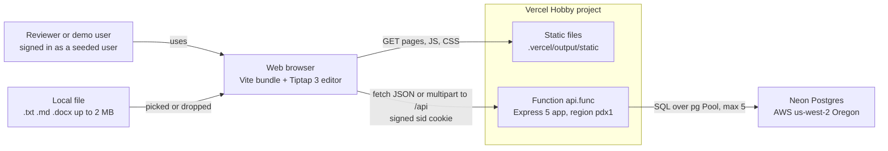

External dependencies at runtime: Vercel (hosting, CDN, function runtime `nodejs22.x`) and Neon (Postgres). There are no other third-party services, no email, and no file storage service.

---

## 3. Composition viewpoint

### 3.1 Components

| Component | File | Responsibility |
|---|---|---|
| Page shell | `src/index.html` | Login screen, sidebar lists, editor view, toolbar, banners, and three `<dialog>`s (share, history, delete) |
| Styles | `src/style.css` | Layout, mobile drawer, print stylesheet used for PDF export |
| Browser app | `src/app.js` | All client logic, grouped into the sections listed in 3.2 |
| API app factory | `server/app.js` `createApp(db, config)` | Middleware chain, routes, `loadDoc` access gate, `recordVersion`, in-memory presence, error handler |
| Database adapter | `server/db.js` `createDb({url, dataDir})` | One interface (`query`, `one`, `all`, `tx`, `close`, `kind`) over `pg.Pool` or PGlite; creates schema and seeds users |
| Session | `server/session.js` `sessions(secret, {secure})` | Stateless signed cookie `sid`: `read`, `set`, `clear` |
| Converter | `server/convert.js` | `fileToHtml`, `markdownToHtml`, `textToHtml`, `zipExpandedSize`, `SUPPORTED` |
| Local entry | `server/index.js` | Reads env, picks Postgres or PGlite (`data/pglite` or in-memory), listens on `PORT` or 3000 |
| Vercel entry | `server/vercel.js` | Lazily builds the app once per instance; turns start-up errors into a JSON 500 and retries on the next request |
| Vercel build | `scripts/build-vercel.mjs` | Writes Build Output API v3: static copy, one esbuild bundle, `.vc-config.json`, `config.json` routes and headers |

### 3.2 Frontend modules (sections of `src/app.js`)

| Section | Key functions |
|---|---|
| API helper | `api()`: fetch wrapper, JSON errors to `Error` with `status`, 401 triggers `sessionExpired()` |
| Auth | `showLogin()`, user-list click to `POST /api/login`, logout, `boot()` |
| Navigation | `setNav()` mobile drawer, `route()` on hash change |
| Document list | `refreshList()`, `createDoc()` |
| Import | `importFile()`, file input and window-level drag and drop |
| Editor | `mountEditor()` (fresh Tiptap `Editor` per document), `openDoc()`, toolbar `COMMANDS`, `updateToolbar()` |
| Saving | `scheduleSave()`, `save()`, `flushSave()`, `setStatus()`, `beforeunload` keepalive save, Ctrl or Cmd+S |
| Presence | `startPresence()`, `stopPresence()`, `renderPresence()`, `accessMayHaveChanged()` |
| History | `selectVersion()`, history button and restore handlers |
| Export | `htmlToMarkdown()` download, `window.print()` for PDF |
| Sharing | `renderShareList()`, add, change role, remove |

### 3.3 Component diagram

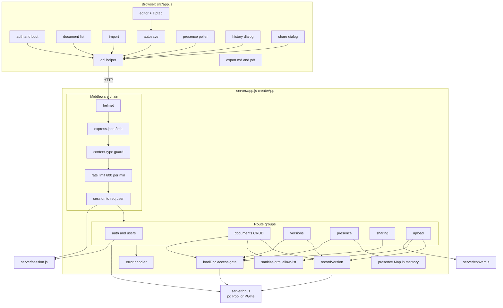

---

## 4. Logical / information viewpoint

### 4.1 Schema
The schema is created by `server/db.js` on start-up in one multi-statement request wrapped in `BEGIN ... COMMIT`, guarded by `pg_advisory_xact_lock(724001)` so two instances that cold-start together do not race. All statements use `IF NOT EXISTS`. Three users are seeded with `ON CONFLICT (email) DO NOTHING`.

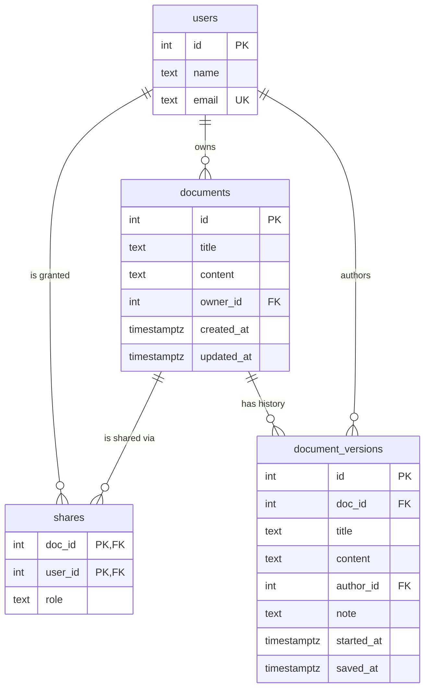

### 4.2 Data dictionary

| Table | Column | Type | Constraints | Meaning |
|---|---|---|---|---|
| users | id | SERIAL | PRIMARY KEY | User id; also the value signed into the `sid` cookie |
| users | name | TEXT | NOT NULL | Display name |
| users | email | TEXT | NOT NULL, UNIQUE | Login key for mocked sign-in and the share target |
| documents | id | SERIAL | PRIMARY KEY | Document id used in `/api/docs/:id` |
| documents | title | TEXT | NOT NULL | Max 200 characters, enforced in `app.js` (`MAX_TITLE`) |
| documents | content | TEXT | NOT NULL, DEFAULT `''` | Sanitised HTML; max 1,000,000 characters on PUT (`MAX_CONTENT`) |
| documents | owner_id | INTEGER | NOT NULL, REFERENCES users(id) | Owner; owner role is derived from this, not from `shares` |
| documents | created_at | TIMESTAMPTZ | NOT NULL, DEFAULT now() | Creation time |
| documents | updated_at | TIMESTAMPTZ | NOT NULL, DEFAULT now() | Set to `now()` on every save and restore; drives list order and the remote-change banner |
| shares | doc_id | INTEGER | NOT NULL, REFERENCES documents(id) ON DELETE CASCADE; part of PK | Shared document |
| shares | user_id | INTEGER | NOT NULL, REFERENCES users(id); part of PK | Grantee |
| shares | role | TEXT | NOT NULL, CHECK role IN ('viewer', 'editor') | Granted role |
| document_versions | id | SERIAL | PRIMARY KEY | Version id; ordering key for "latest" |
| document_versions | doc_id | INTEGER | NOT NULL, REFERENCES documents(id) ON DELETE CASCADE | Parent document |
| document_versions | title | TEXT | NOT NULL | Title snapshot |
| document_versions | content | TEXT | NOT NULL | Full HTML snapshot |
| document_versions | author_id | INTEGER | NOT NULL, REFERENCES users(id) | Who saved it |
| document_versions | note | TEXT | nullable | NULL for autosave versions; set for restore ("Restored the version from ...") and import ("Imported from ...") |
| document_versions | started_at | TIMESTAMPTZ | NOT NULL, DEFAULT now() | Start of the 10-minute folding window; never updated |
| document_versions | saved_at | TIMESTAMPTZ | NOT NULL, DEFAULT now() | Last time this version was written; updated when autosaves fold in |

Indexes: `documents_owner_idx (owner_id)`, `shares_user_idx (user_id)`, `versions_doc_idx (doc_id, id DESC)`. The primary key `(doc_id, user_id)` serves lookups by document on `shares`.

### 4.3 Data rules
- Primary key `(doc_id, user_id)` means one role per user per document. A role change is an upsert (`ON CONFLICT (doc_id, user_id) DO UPDATE`).
- Deleting a document removes its shares and versions by cascade. Users are never deleted.
- History is capped at `MAX_VERSIONS_PER_DOC = 100` per document, pruned after each new version row. `GET .../versions` returns at most 50.
- Non-persistent state: presence lives in a process-local `Map(docId -> Map(userId -> {name, at}))` with a 30 s TTL, and rate-limit counters are in memory. Both are per instance.

---

## 5. Interface viewpoint

All responses are JSON. Errors are `{ "error": "<message>" }`. "Auth" means the `requireUser` middleware (401 `Not signed in` if missing). "Role" means the effective role returned by `loadDoc`, which first returns 404 for a non-numeric, out-of-int4 or missing id and 403 when the caller has no role.

| Method | Path | Auth / role | Request | Success response | Route-specific errors |
|---|---|---|---|---|---|
| GET | `/api/health` | none | none | `{ ok: true, db: "postgres" or "pglite" }` | none |
| GET | `/api/users` | none | none | `[ { id, name, email } ]` ordered by id | none |
| POST | `/api/login` | none; extra limiter 20 failed attempts per 15 min | `{ email }` | user `{ id, name, email }`; sets `sid` cookie | 404 Unknown user; 429 |
| POST | `/api/logout` | none | none | `{ ok: true }`; clears cookie | none |
| GET | `/api/me` | none | none | user or `null` | none |
| GET | `/api/docs` | auth | none | `{ owned: [ {id, title, updated_at} ], shared: [ {id, title, updated_at, role, owner_name} ] }`, newest first | 401 |
| POST | `/api/docs` | auth | `{ title? }` (trimmed, cut to 200, default "Untitled document") | 201 `{ id }` | 401 |
| GET | `/api/docs/:id` | any role | none | `{ id, title, content, updated_at, owner: {name, email}, role, shares }`; `shares` is filled only for the owner | 401, 403, 404 |
| PUT | `/api/docs/:id` | owner or editor | `{ title?, content? }` | `{ ok: true, updated_at }` | 400 Nothing to update, Title cannot be empty, title over 200, Content must be an HTML string; 403 viewer; 413 content over 1,000,000 chars |
| DELETE | `/api/docs/:id` | owner | none | `{ ok: true }` | 403 not owner |
| GET | `/api/docs/:id/versions` | any role | none | up to 50 `{ id, title, note, saved_at, author_name }`, newest first | 403, 404 |
| GET | `/api/docs/:id/versions/:vid` | any role | none | `{ id, title, content, note, saved_at, author_name }` | 404 Version not found (also when `vid` belongs to another document) |
| POST | `/api/docs/:id/versions/:vid/restore` | owner or editor | none | `{ ok: true, updated_at }` | 403 viewer; 404 |
| POST | `/api/docs/:id/presence` | any role | none | `{ others: [ {id, name} ], updated_at, last_editor }` | 403, 404 |
| DELETE | `/api/docs/:id/presence` | any role | none | `{ ok: true }` | 403, 404 |
| POST | `/api/docs/:id/share` | owner | `{ email, role: "viewer" or "editor" }` | `{ ok: true }` (insert or role change) | 400 bad role, owner already has access; 403 not owner; 404 no user with that email |
| DELETE | `/api/docs/:id/share/:userId` | owner | none | `{ ok: true }` | 403 not owner; 404 User not found for a bad id |
| POST | `/api/upload` | auth; extra limiter 30 per 10 min | multipart, field `file`, one file, max 2 MB | 201 `{ id }` of the new document | 400 no file or malformed upload; 413 file over 2 MB or `.docx` expanding over 20 MB; 415 unsupported extension; 422 unreadable `.docx`; 429 |
| GET | `/api/upload/supported` | none | none | `{ extensions: [".txt", ".md", ".docx"], maxBytes: 2097152 }` | none |
| any | other `/api/...` | n/a | n/a | n/a | 404 Not found |

Errors that can come from any `/api` route: 415 Unsupported content type (a body that is not JSON or multipart), 400 Malformed JSON, 413 Request too large (JSON body over 2 MB), 429 Too many requests (600 per minute per IP), 500 Internal server error (details logged server-side, never returned).

Non-API paths are served as static files: by `express.static('dist')` locally, and by the Vercel CDN in production.

---

## 6. Interaction viewpoint

### 6.1 Sign-in with a signed cookie

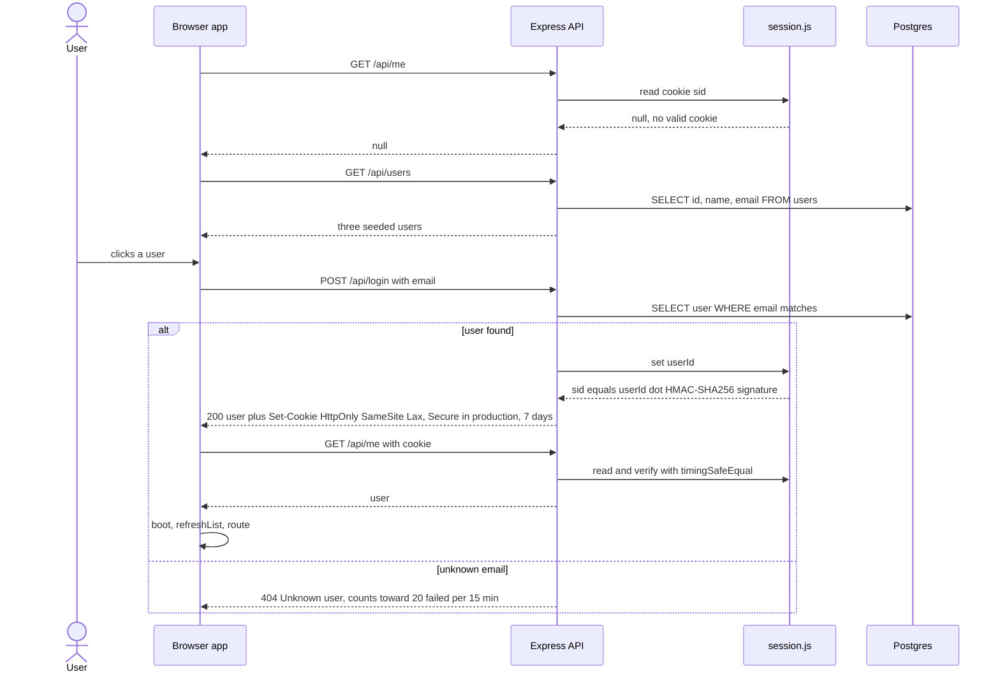

### 6.2 Autosave of a document

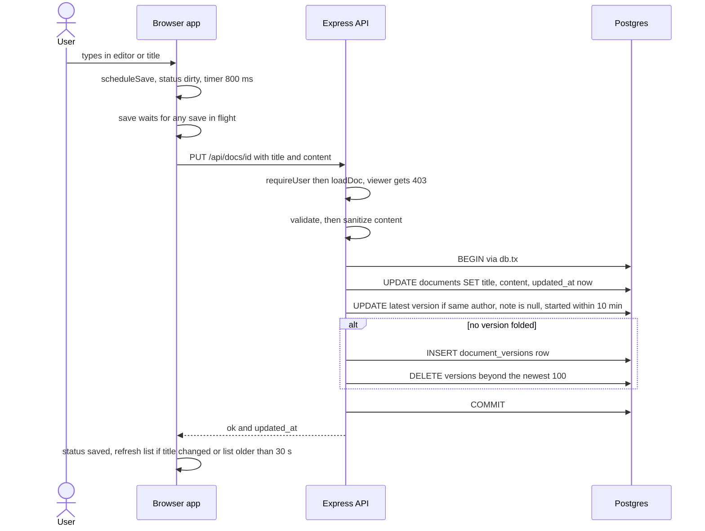

### 6.3 Sharing a document

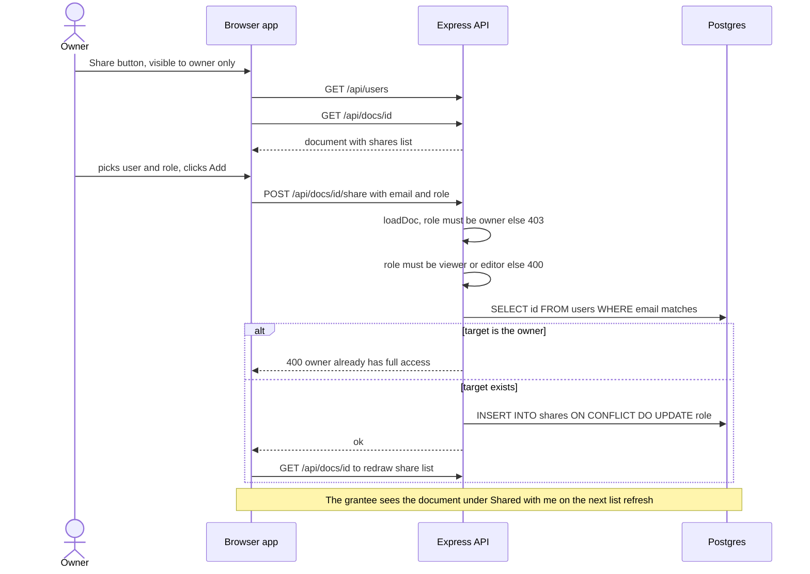

### 6.4 File import

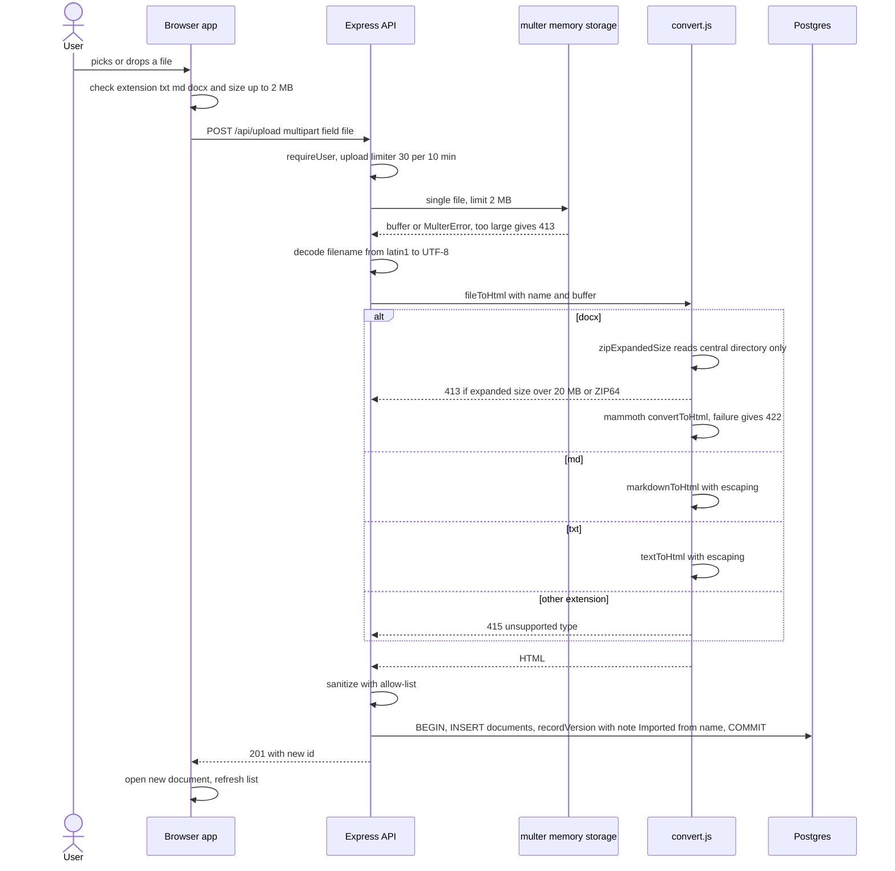

### 6.5 Presence polling and the remote-change banner

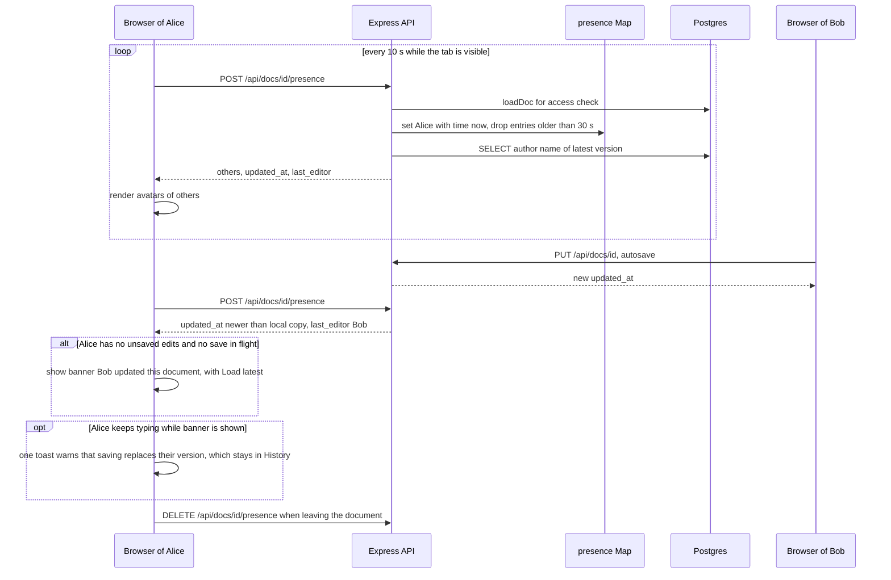

If a presence or save call returns 403 or 404 for an open document, `accessMayHaveChanged()` drops unsaved state and reopens the document so the UI picks up the new role.

### 6.6 Version restore

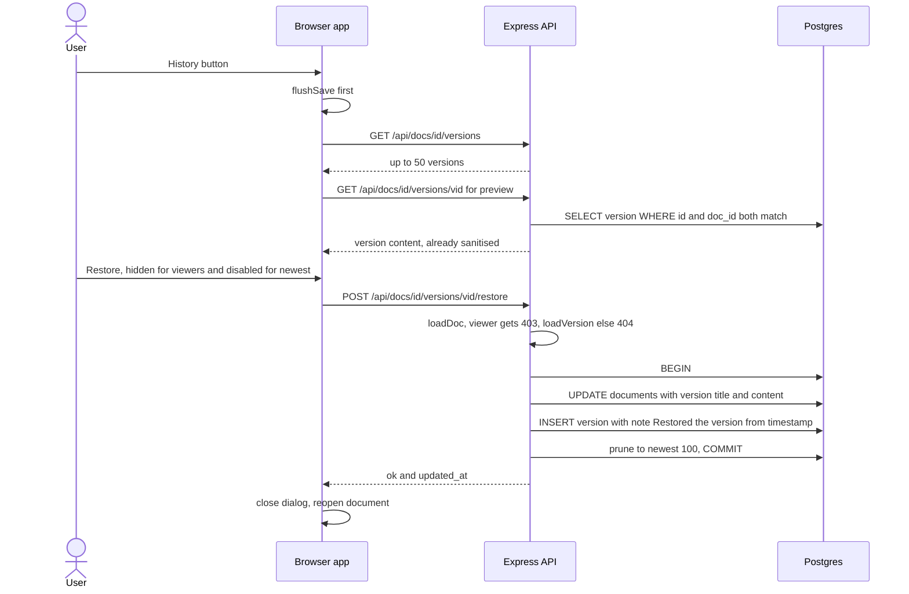

---

## 7. State dynamics viewpoint

### 7.1 Editor save status
The status is held in `#save-status` (`data-state` attribute) and set by `setStatus()` in `src/app.js`.

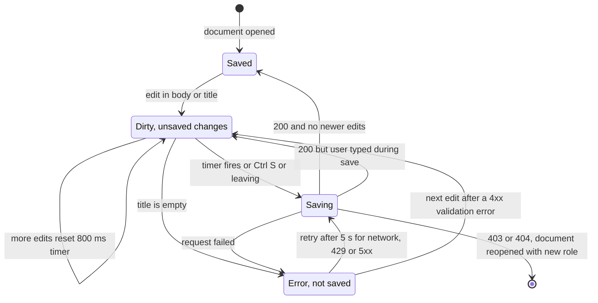

Guarantees: only one save is in flight at a time (`await state.saving`), so an older save never lands after a newer one. On tab close a final save is sent with `keepalive: true`. Leaving a document with unsaved changes after a failed save asks for confirmation (`flushSave()`).

### 7.2 Document access per user

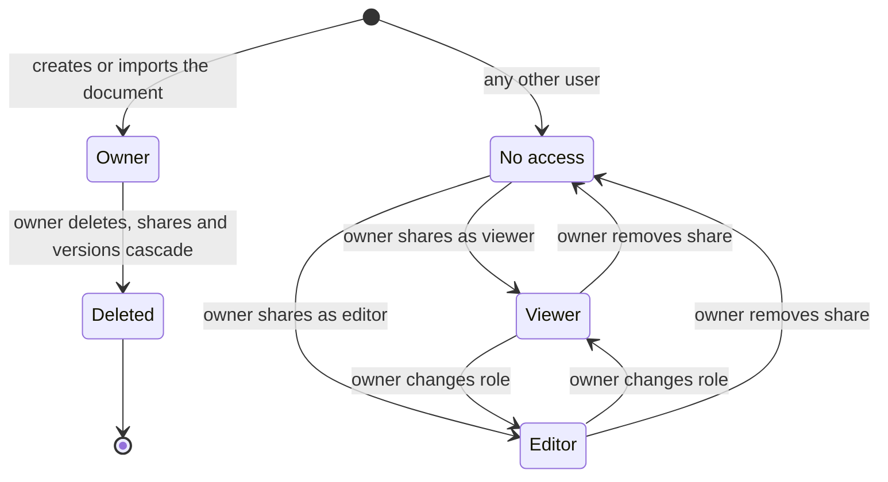

| Action | Owner | Editor | Viewer | No access |
|---|---|---|---|---|
| Read document, versions, presence | yes | yes | yes | 403 |
| Edit title or content, restore a version | yes | yes | 403 | 403 |
| Share, change role, unshare, delete | yes | 403 | 403 | 403 |

Ownership never transfers; there is no route for it.

---

## 8. Request pipeline

Order is exactly as registered in `createApp`. Express 5 forwards rejected promises from async handlers to the error handler, so handlers simply `throw new HttpError(status, message)`.

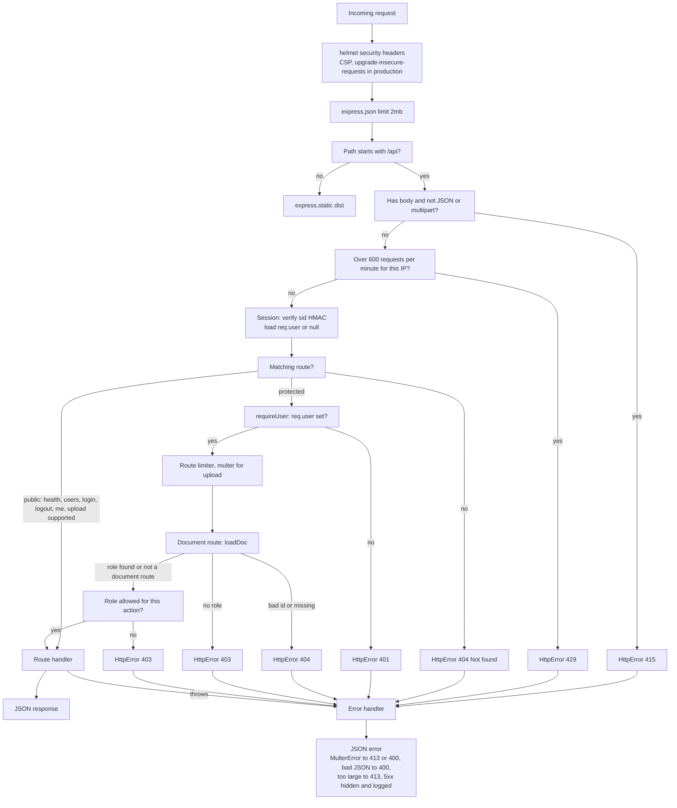

Notes:
- The login route has its own limiter (20 failed attempts per 15 minutes, `skipSuccessfulRequests`). The upload route has one too (30 per 10 minutes), placed after `requireUser` and before multer.
- In production `trust proxy` is set to 1, so the rate limiter sees the real client IP behind Vercel.

---

## 9. Deployment viewpoint

### 9.1 Build
`vercel.json` sets `buildCommand: npm run build:vercel` and `regions: ["pdx1"]`. That script runs `vite build && node scripts/build-vercel.mjs`.

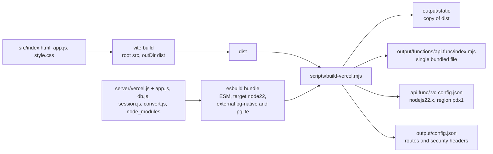

The single bundle exists because Vercel's function loader cannot `require()` ESM-only packages such as `sanitize-html`'s `htmlparser2` dependency at runtime (comment in `server/vercel.js`). PGlite is left out of the bundle, so production never loads its WASM.

### 9.2 Runtime

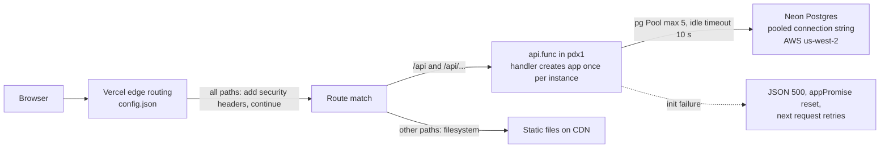

Runtime configuration (names only): `SESSION_SECRET` (required, at least 32 characters) and `DATABASE_URL` (required on Vercel). On the first request per instance, `createDb` runs the schema and seed. The pool's idle timeout (10 s) is shorter than Neon's 5-minute auto-suspend, and a pool `error` listener stops a dropped idle connection from crashing the process.

Local and test runtime: `server/index.js` uses PGlite in `data/pglite`, or in memory when `DB_IN_MEMORY` is set. Tests (`node --test test/*.test.js`) use in-memory PGlite. `Dockerfile` and `render.yaml` remain as an alternative host path (ADR-004).

---

## 10. Security design

| Threat | Design response | Where | Residual risk |
|---|---|---|---|
| Stored XSS through document content | Server-side `sanitize-html` allow-list on every content write (PUT and upload): `p, br, h1-h3, strong, b, em, i, u, s, ul, ol, li, blockquote, a, code, pre, hr`; only `href, target, rel` on `a`; schemes `http, https, mailto`. Tiptap schema normalises input on the client too | `server/app.js` `SANITIZE`, `clean()` | Content is rendered with `innerHTML` by design; safety relies on the allow-list |
| XSS through names, titles, notes | `escapeHtml()` on every server string placed into `innerHTML`, except sanitised content | `src/app.js` | none known |
| Script injection in general | CSP: helmet default policy on the API; on Vercel, `config.json` adds `script-src 'self'`, `script-src-attr 'none'`, `object-src 'none'`, `frame-ancestors 'self'`, `upgrade-insecure-requests` | `server/app.js`, `scripts/build-vercel.mjs` | `style-src` allows `'unsafe-inline'` |
| Reverse tabnabbing via stored links | Every `a` is rewritten with `rel="noopener noreferrer nofollow"` | `transformTags` in `SANITIZE` | none known |
| CSRF | Cookie is `SameSite=Lax`, so cross-site POST, PUT and DELETE carry no cookie. Defence in depth: `/api` bodies must be JSON or multipart (415 otherwise), which blocks urlencoded and text/plain form posts. No CORS headers are sent | `server/session.js`, content-type guard | Multipart is accepted for upload, so that route relies on SameSite alone |
| Session forgery or tampering | Cookie value is `userId.issuedAt.HMAC-SHA256(userId.issuedAt)` with a server secret of at least 32 characters; compared with `crypto.timingSafeEqual`; `HttpOnly`; `Secure` in production; 7-day `Max-Age` | `server/session.js` | Stateless: the server rejects cookies older than 7 days; a stolen cookie cannot be revoked sooner except by rotating the secret |
| Impersonation | Mocked sign-in lets anyone choose a seeded user, as the brief allows | ADR-006 | Accepted for the assessment; real auth is a listed next step |
| IDOR on documents | `loadDoc()` is the only access gate: one query joins document, owner and the caller's share row and returns the role or 404/403; every document route calls it first | `server/app.js` | none known |
| IDOR on versions | `loadVersion()` requires `id` and `doc_id` to match, so a version id from another document is 404 | `server/app.js` | none known |
| Bad ids causing 500s | `toId()` accepts only positive int4 values; anything else is 404 | `server/app.js` | none known |
| Zip bomb in `.docx` | `zipExpandedSize()` sums declared uncompressed sizes from the zip central directory without inflating; over 20 MB or ZIP64 is rejected with 413 before mammoth runs | `server/convert.js` | Relies on declared sizes; mammoth still parses accepted files |
| Large uploads and bodies | multer memory storage, 2 MB, one file; JSON body limit 2 MB; content limit 1,000,000 chars; title limit 200 | `server/app.js` | none known |
| Brute force and flooding | General 600 requests per minute per IP on `/api`; login 20 failed per 15 minutes; upload 30 per 10 minutes; `trust proxy` in production for real IPs | `server/app.js` | Counters are in memory, so per Vercel instance (best effort, ADR-004) |
| Unbounded history growth | Autosaves fold into one version per author per 10 minutes; hard cap 100 versions per document | `recordVersion()` | none known |
| Information leakage | 5xx responses say only "Internal server error"; detail is logged server-side; `x-powered-by` disabled | error handler | none known |
| Transport and framing | HSTS one year with subdomains, `X-Frame-Options: SAMEORIGIN`, `X-Content-Type-Options: nosniff`, `Referrer-Policy: no-referrer` on Vercel | `scripts/build-vercel.mjs` | none known |
| Vulnerable dependencies | multer upgraded to 2.4.0 (fixes CVEs in 1.x); mammoth audit findings sit in its CLI only | ADR-005 | Accepted, recorded in ADR-005 |

---

## 11. Design rationale

### 11.1 Decisions from `docs/DECISIONS.md`

| ADR | Decision | Alternatives rejected | Why |
|---|---|---|---|
| ADR-001 | Tiptap v3 (ProseMirror) editor | `contenteditable` + `execCommand` (deprecated, produced invalid nested HTML); Lexical, BlockNote (pre-1.0); Quill (low momentum) | Only stable, maintained option covering bold, italic, underline, headings and lists out of the box; schema-enforced HTML; MIT; path to Yjs collaboration |
| ADR-002 | Express 5 API + vanilla JS bundled by Vite | Express 4 (superseded); Next.js 16 + React 19 (more complexity and delivery risk in the timebox) | Smallest stack that still separates frontend, API, persistence and access logic; Express 5 forwards async errors natively |
| ADR-003 | Postgres on Neon in production; PGlite in dev and tests | SQLite on the app server (ephemeral disk on free hosting, `node:sqlite` not stable); Supabase free (pauses); Turso (free limits not verifiable from official docs) | Durable free storage that survives between reviewer visits; same SQL dialect in tests with zero setup |
| ADR-004 | Vercel Hobby, single function in pdx1 next to Neon Oregon | Render (card verification at signup from Pakistan); Railway (trial credit only); Fly.io (no free tier) | Free with no card; Express runs as one function; static files on CDN. Trade-off: in-memory presence and rate limits are per instance |
| ADR-005 | multer 2.4.0, mammoth 1.13.0, server-side sanitize-html | multer 1.4.5-lts.2 (13 CVEs fixed in 2.x) | Current, patched upload handling; the server stays the trust boundary even with Tiptap's schema |
| ADR-006 | Mocked auth: pick a seeded user, signed httpOnly cookie | OAuth or magic link | Allowed by the brief; time spent on sharing and access control instead |
| ADR-007 | `node:test` with real HTTP requests against in-memory PGlite | (Playwright UI test deferred at the time; `e2e/app.spec.js` now exists) | Built-in and stable; covers roles, sanitisation, upload and validation |

### 11.2 Design-level choices visible in the code

| Choice | Alternative | Reason |
|---|---|---|
| Store content as sanitised HTML | JSON document model | Keeps formatting exactly and makes import and export simple; JSON is the choice once real-time collaboration lands (`ARCHITECTURE.md`) |
| Stateless HMAC cookie | Server-side session table | No session storage or extra query beyond loading the user; works across function instances |
| One access gate, `loadDoc()` | Checks repeated in each route | One place to review and test; role derived from `owner_id` plus `shares` |
| Save and version in one `db.tx` | Two independent statements | The document and its history can never disagree |
| Version folding by author and 10-minute window | One version per autosave | Autosave fires about once a second; folding keeps history readable and bounded |
| Last write wins, with a remote-change banner and overwrite warning | Optimistic concurrency (409 on conflict) | Fits the timebox; previous content stays in History. Optimistic concurrency is next step 1 in `ARCHITECTURE.md` |
| Presence by 10 s polling with 30 s TTL in memory | WebSockets, Redis, Yjs awareness | Works through any proxy and on serverless; single-instance limit is marked with a `shortcut:` comment |
| One esbuild bundle via Build Output API v3 | Vercel's default Node builder | Avoids runtime `require()` of ESM-only packages; keeps PGlite out of production |
| PDF export via print stylesheet | Server-side PDF library | Nothing extra to maintain; output depends on the browser |
