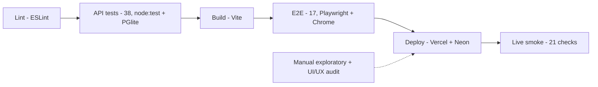
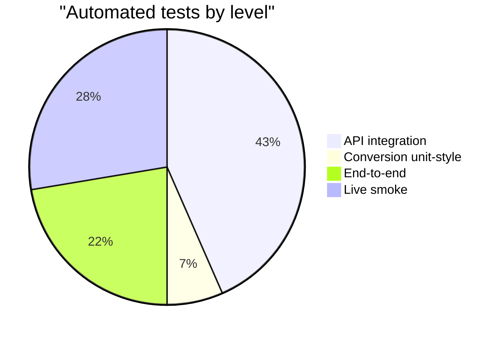

# Ajaia Docs: Test Documentation

| Field | Value |
|---|---|
| Document ID | AJD-TST-001 |
| Version | 1.0 |
| Date | 2026-10-14 |
| Author | Danish Ahmed |
| Status | Final for submission |
| Standards | Structured after ISO/IEC/IEEE 29119-3:2021 (successor of IEEE 829-2008); V&V summary references IEEE 1012-2016 |

## 1. Introduction

This document records how Ajaia Docs was tested: what was planned, how tests were designed, every automated test case, how to run them, the defects found, and the final results.

Ajaia Docs is a lightweight collaborative document editor built as a timed hiring assessment. It supports sign-in by email (no passwords), rich-text documents, sharing with editor and viewer roles, file import (.txt, .md, .docx), export (Markdown and PDF), version history with restore, and presence.

The document is **structured after** ISO/IEC/IEEE 29119-3:2021. It uses that standard's artefact names (test plan, test design, test case specification, test procedure, incident report, test completion report). It is not a certified or audited conformance claim.

Related documents: `docs/TESTING.md` (testing guide and manual script), `docs/SDLC.md` (lifecycle and defect log D1 to D27), `docs/DECISIONS.md` (ADRs).

## 2. Test Plan

### 2.1 Scope

In scope: the Express API, the Tiptap-based web client, file conversion, the Vercel build output, and the deployed site at https://ajaia-docs-three-pi.vercel.app.

Out of scope: real authentication (the app uses email-only demo sign-in by design), real-time co-editing (not built), load and performance testing, browsers other than Chrome, automated accessibility scanning (axe).

### 2.2 Test items

| Item | Location |
|---|---|
| API server | `server/` (Express 5, sanitize-html, multer 2) |
| Data layer | `server/db.js` (Postgres via `pg` on Neon; PGlite in-memory for dev and test) |
| Web client | Tiptap editor built with Vite |
| Vercel bundle | `scripts/build-vercel.mjs` (esbuild, Build Output API v3) |
| Deployed system | https://ajaia-docs-three-pi.vercel.app |

### 2.3 Features to be tested

| Area | Features |
|---|---|
| Auth | Sign-in, signed session cookie, session expiry, switch user |
| Documents | Create, rename, edit, reopen, delete, validation, formatting kept |
| Sharing | Share as editor or viewer, re-share, unshare, role enforcement |
| Upload | Import .txt, .md, .docx; reject unsupported, empty, corrupt, oversized |
| Versions | Version grouping, restore, history cap, access rules |
| Presence | Members see each other, last editor, strangers refused |
| Security | HTML sanitising, cookie flags, security headers, CSRF-style form posts, rate limiting, id validation |
| Export | Markdown export (incl. nested lists), PDF via print layout |
| UX | Keyboard-only use, phone layout, 44 px touch targets, drop to import, Ctrl+S |
| Deployment | Self-contained Vercel bundle, routing, headers, missing-secret handling |

### 2.4 Features not to be tested

| Feature | Reason |
|---|---|
| Password or SSO authentication | Not part of the product; demo sign-in by design |
| Real-time co-editing | Not built |
| Load and performance | Free-tier demo; outside the timebox |
| Firefox, Safari | E2E runs in Chrome only |

### 2.5 Approach (test levels)

| Level | Tool | What it covers |
|---|---|---|
| Unit-style conversion tests | `node:test` | `textToHtml`, `markdownToHtml`, `fileToHtml` in isolation |
| API integration | `node:test` over real HTTP | Real app on a random port against in-memory PGlite Postgres (`test/helpers.js`), one session per user |
| End-to-end | Playwright, installed Chrome (`channel: 'chrome'`) | Real browser, three users (Alice, Bob, Carol), in-memory DB; single-browser tests also fail on any console error |
| Live smoke | Scripted HTTP checks | 21 checks against production: roles, sanitising, sharing, versions, presence, import, security headers |
| Manual exploratory | Human, browser | 14-step manual script in `docs/TESTING.md` |
| Scripted UI/UX audit | Browser script (light and dark) | Tap size (44 px guideline), colour contrast, focus rings |
| Mutation check | Hand-injected bugs | Confirms the suite fails on 4 deliberate server bugs |

### 2.6 Environment

| Element | Value |
|---|---|
| OS | Windows 11 |
| Runtime | Node.js 22.12 or newer (`engines` field) |
| Browser | Google Chrome via Playwright `channel: 'chrome'` (override with `PW_CHANNEL`) |
| Test database | PGlite in-memory Postgres (`DB_IN_MEMORY=1` for E2E) |
| E2E server | `npm run build && node server/index.js` on port 3100, health check `/api/health` |
| Production | Vercel serverless function plus Neon Postgres (free tier) |
| Test accounts | `alice@example.com`, `bob@example.com`, `carol@example.com` (seeded, no passwords) |

### 2.7 Entry and exit criteria

Entry: code builds; dependencies installed; Chrome available; no secrets in the repo.

Exit (all must hold):
1. `npm run check` passes: lint clean, all API tests pass, build succeeds.
2. `npm run test:e2e` passes with zero retries (`retries: 0`).
3. Live smoke checks pass against the deployed site.
4. Every defect in the log is fixed and, where practical, covered by a regression test.

### 2.8 Risks

| Risk | Mitigation |
|---|---|
| PGlite and Neon differ in behaviour | Same SQL and schema path; live smoke run against Neon after deploy |
| Vercel loader differs from local Node | Test loads the bundle from a folder with no `node_modules` (API-36) |
| Shared in-memory DB makes E2E order-sensitive | `fullyParallel: false`; tests share users, not documents |
| Timebox pressure skips testing | Quality gates at every iteration (`docs/SDLC.md`) |

### 2.9 Roles

| Role | Person |
|---|---|
| Product owner, reviewer, approver | Danish Ahmed |
| Test design, implementation and execution (AI pair) | Claude Code, results shown to Danish |

### 2.10 Schedule

Single day, 2026-10-14 (PKT). Testing ran in each iteration from about 11:00; independent reviews and regression tests at about 13:00; UX pass at about 13:15; UI/UX audit at about 13:35; final verified run at 13:39.

## 3. Test Design

### 3.1 Pipeline and test pyramid





The 38 tests run by `npm test` are split above into 33 API integration tests and 5 conversion tests (`test/convert.test.js`).

### 3.2 Feature-to-test mapping

| Feature area | API / unit tests | E2E tests |
|---|---|---|
| Auth | API-06, API-12, API-13, API-16 | E2E-06, E2E-11, E2E-17 |
| Documents | API-01, API-02, API-07 | E2E-01, E2E-05, E2E-10 |
| Sharing | API-03, API-08 to API-11 | E2E-02, E2E-12 |
| Upload / import | API-04, API-05, API-22 to API-26, API-29, API-30 | E2E-03, E2E-14 |
| Versions | API-17 to API-20, API-31 | E2E-07 |
| Presence | API-21 | E2E-08 |
| Security | API-01, API-12 to API-16, API-27, API-28 | E2E-02 (viewer API write = 403) |
| Export | none (client-side) | E2E-04, E2E-09, E2E-13 |
| UX | none | E2E-05, E2E-06, E2E-14, E2E-15, E2E-16 |
| Deployment and resilience | API-32 to API-38 | none |

## 4. Test Case Specification

### 4.1 API and conversion tests (`npm test`, 38)

| ID | File | Test name | Verifies | Area |
|---|---|---|---|---|
| API-01 | test/api.test.js | documents: create, rename, edit, reopen; formatting kept, scripts stripped | Full document lifecycle; formatting survives; `<script>` and `onerror` removed | Documents, security |
| API-02 | test/api.test.js | documents: validation errors | Empty or long title, wrong types, 1 MB cap rejected | Documents |
| API-03 | test/api.test.js | sharing: owned vs shared lists and role enforcement | Owned and shared lists; viewers cannot write | Sharing |
| API-04 | test/api.test.js | upload: .txt and .md become editable docs; unsupported type and empty request rejected | Import creates owned docs; bad input refused | Upload |
| API-05 | test/api.test.js | upload keeps non-ASCII filenames intact | Filename encoding preserved in title | Upload |
| API-06 | test/api.test.js | unauthenticated, malformed and unknown requests get clean JSON errors | 401, 400, 404 JSON shapes | Auth, security |
| API-07 | test/api.test.js | deleting a document removes it for everyone it was shared with | Delete cascades to shares | Documents |
| API-08 | test/sharing.test.js | owner sees the share list; editors and viewers do not | Share list visibility | Sharing |
| API-09 | test/sharing.test.js | re-sharing changes the role instead of duplicating | Upsert of role | Sharing |
| API-10 | test/sharing.test.js | invalid share requests are rejected | Self, unknown user, invalid role refused | Sharing |
| API-11 | test/sharing.test.js | unsharing revokes access immediately; only the owner can unshare | Revocation and owner-only unshare | Sharing |
| API-12 | test/security.test.js | session cookie is signed: tampered, forged or unsigned cookies are rejected | Cookie signature enforced | Auth, security |
| API-13 | test/security.test.js | session cookie attributes: HttpOnly, SameSite=Lax, Secure only in production | Cookie flags | Auth, security |
| API-14 | test/security.test.js | security headers are set (CSP, nosniff, frame protection, no x-powered-by) | Response headers | Security |
| API-15 | test/security.test.js | API rejects non-JSON bodies (blocks form-encoded cross-site posts) | 415 on non-JSON writes | Security |
| API-16 | test/security.test.js | failed logins are rate limited (429 after 20); successful logins are not counted | Login rate limit | Auth, security |
| API-17 | test/versions.test.js | autosaves by one person fold into one version; another author starts a new one | Version grouping per author | Versions |
| API-18 | test/versions.test.js | restore brings back an old version and is itself recorded | Restore and audit trail | Versions |
| API-19 | test/versions.test.js | viewers can see history but not restore; strangers see nothing | Version access rules | Versions, sharing |
| API-20 | test/versions.test.js | importing a file records the first version with a note | Import creates version 1 | Versions, upload |
| API-21 | test/versions.test.js | presence: members see each other; it reports the last editor; strangers are refused | Presence API | Presence |
| API-22 | test/convert.test.js | textToHtml: paragraphs on blank lines, line breaks kept, HTML escaped | Plain-text conversion | Upload |
| API-23 | test/convert.test.js | markdownToHtml: headings, emphasis, lists, paragraphs, escaping | Markdown subset | Upload |
| API-24 | test/convert.test.js | fileToHtml: .docx converted with headings and bold kept | Real generated .docx | Upload |
| API-25 | test/convert.test.js | fileToHtml: unsupported or extension-less files are rejected with 415 | Type check | Upload |
| API-26 | test/convert.test.js | fileToHtml: a corrupt .docx fails cleanly instead of crashing | Corrupt file handling | Upload |
| API-27 | test/review-fixes.test.js | ids outside Postgres int range, or not numbers, give 404 instead of a 500 | Id validation (D10) | Security |
| API-28 | test/review-fixes.test.js | links always get rel="noopener noreferrer nofollow" (no reverse tabnabbing) | Link sanitising (D13) | Security |
| API-29 | test/review-fixes.test.js | a malformed multipart upload is a 400, not a 500 | Upload error mapping (D14) | Upload |
| API-30 | test/review-fixes.test.js | a .docx that expands beyond 20 MB is refused before mammoth unpacks it (zip bomb) | Zip bomb guard (D11) | Upload, security |
| API-31 | test/review-fixes.test.js | version history is capped per document when authors take turns | 100-version cap (D12) | Versions |
| API-32 | test/review-fixes.test.js | production refuses to start without DATABASE_URL (no silent throwaway database) | Production config guard (D15) | Deployment |
| API-33 | test/review-fixes.test.js | start-up against an unreachable database fails cleanly (no hang, pool closed) | DB failure handling (D9) | Deployment |
| API-34 | test/review-fixes.test.js | schema setup is idempotent: restarting on the same database keeps data and seeds once | Schema and seed idempotency (D17) | Deployment |
| API-35 | test/vercel.test.js | bundled function serves the API (Vercel-style handler, Secure cookies) | Bundle works as a Vercel handler | Deployment |
| API-36 | test/vercel.test.js | bundle is self-contained: it loads with no node_modules at all (the Vercel failure mode) | Regression for D8 | Deployment |
| API-37 | test/vercel.test.js | missing secrets fail with a clear JSON 500, not a crash | Missing-secret handling | Deployment |
| API-38 | test/vercel.test.js | Vercel output: static site, one function, /api routed to it, security headers on every response | Build Output API v3 layout | Deployment, security |

### 4.2 End-to-end tests (`npm run test:e2e`, 17, file `e2e/app.spec.js`)

| ID | Test name | Verifies | Area |
|---|---|---|---|
| E2E-01 | owner creates, formats, saves and reopens a document | Create, format, autosave, reload | Documents |
| E2E-02 | owner shares: editor can edit, viewer is read-only, stranger is denied | Roles in the UI; direct API write as viewer = 403 | Sharing, security |
| E2E-03 | import a Markdown file as a new document; unsupported files are refused | Import via UI | Upload |
| E2E-04 | export downloads Markdown that matches the document | Markdown export | Export |
| E2E-05 | typing straight after "New document" never lands in the previous document | Doc-switch race | Documents, UX |
| E2E-06 | keyboard-only: sign in, create a doc and type without the mouse | Keyboard access (D23) | UX, auth |
| E2E-07 | version history: see who changed what and restore an older version | History and restore across two users | Versions |
| E2E-08 | presence: collaborators see who else is in the document and get told about their edits | Two-browser presence and update notice | Presence |
| E2E-09 | export PDF prints only the document | Print layout | Export |
| E2E-10 | review fix: pressing Escape in the delete dialog never deletes (even after a previous delete) | Regression for D18 | Documents |
| E2E-11 | review fix: switching user without a reload shows nothing of the previous user's document | Regression for D19 | Auth, security |
| E2E-12 | review fix: an editor whose access is downgraded mid-session is switched to read-only | Regression for D21 | Sharing |
| E2E-13 | review fix: Markdown export keeps nested lists and puts marks around the words | Regression for D22 | Export |
| E2E-14 | ux: dropping a file anywhere imports it; Ctrl+S saves without the browser dialog | Regression for D26 | UX, upload |
| E2E-15 | ux: on a phone the home screen has a compact top bar and opens the documents menu | Regression for D25 | UX |
| E2E-16 | ux: on touch screens every editor control is at least 44px to tap | Regression for D27 | UX |
| E2E-17 | expired session sends the user back to sign-in | Session expiry handling | Auth |

## 5. Test Procedure

Install dependencies once:

```bash
npm install
```

Level 1 to 3, the full quality gate (lint, 40 API tests, production build):

```bash
npm run check
```

Run the levels separately if needed. Lint:

```bash
npm run lint
```

API and conversion tests:

```bash
npm test
```

Production build:

```bash
npm run build
```

End-to-end tests (builds, starts the server on port 3100 with an in-memory DB, drives installed Chrome):

```bash
npm run test:e2e
```

If Google Chrome is not installed, install Playwright's Chromium:

```bash
npx playwright install chromium
```

Then run E2E against it:

```bash
PW_CHANNEL=chromium npm run test:e2e
```

Manual exploratory testing: start the app locally, then follow the 14-step script in `docs/TESTING.md`:

```bash
npm run dev
```

Quick security spot checks against a local server (expect 401, the security headers, and 415):

```bash
curl -i http://localhost:3000/api/docs
```

```bash
curl -I http://localhost:3000/
```

```bash
curl -i -X POST http://localhost:3000/api/login -H "content-type: text/plain" -d "email=alice@example.com"
```

Live smoke: run the 21 scripted HTTP checks against https://ajaia-docs-three-pi.vercel.app after each deploy. The smoke script is not committed to this repository.

## 6. Incident (Defect) Report Summary

Source: defect log in `docs/SDLC.md`. All 27 defects are closed.

| ID | Found by | Summary | Fix | Regression test |
|---|---|---|---|---|
| D1 | Claude (tool output) | Bash heredoc silently wrote no files | Direct file writes | None (tooling) |
| D2 | `npm test` | `node --test test/` fails on Windows | Explicit `test/*.test.js` glob | The `npm test` script itself |
| D3 | Browser check | Editor nested `<ul>` inside `<p>` | Replaced editor with Tiptap (ADR-001) | API-01, E2E-01 |
| D4 | Official docs | multer 1.4.5-lts had 13 CVEs fixed in 2.x | Upgraded to multer 2.4.0 | None (`npm ls`) |
| D5 | Official docs | Render free storage is ephemeral | Moved to Neon Postgres (ADR-003) | Live smoke |
| D6 | Server start | PGlite fails if `data/` is missing on a fresh clone | Create folder recursively | None (clean-checkout boot) |
| D7 | Browser console | Toolbar TDZ `ReferenceError` blocked every transaction | Renamed destructured variable | E2E-01, E2E-06 |
| D8 | Vercel production logs | Every API call 500: ESM-only htmlparser2 v12 not loadable from CommonJS | Self-contained esbuild bundle, Build Output API v3 | API-35, API-36, API-38 |
| D9 | Server review | pg pool had no error listener | `pool.on("error")`, idle timeout 10 s | API-33 |
| D10 | Server review | Out-of-range or non-numeric ids gave 500 | `toId()` validation, 404 | API-27 |
| D11 | Server review | .docx zip bomb could inflate to GBs | Check central directory; refuse over 20 MB (413) | API-30 |
| D12 | Server review | Alternating authors grew history without bound | Cap at 100 versions per document | API-31 |
| D13 | Server review | Links could keep `rel="opener"` | Force `rel="noopener noreferrer nofollow"` | API-28 |
| D14 | Server review | Malformed multipart upload gave 500 | Map Busboy errors to 400 | API-29 |
| D15 | Server review | Production could run on throwaway local DB | Refuse to start without `DATABASE_URL` | API-32 |
| D16 | Server review | Document update and version insert not atomic | `db.tx()` for save, restore, import | All API tests |
| D17 | Server review | Cold start: 10 round trips and CREATE TABLE race | Single batch under advisory lock; seed in one INSERT | API-34 |
| D18 | Frontend review | Escape in delete dialog could delete | Reset `returnValue` before opening | E2E-10 |
| D19 | Frontend review | After Switch user, previous user's doc visible | `closeDocView()` on logout and expiry | E2E-11 |
| D20 | Frontend review | Races in doc switching, history, save state, presence | Sequence and selection guards | Existing E2E plus code trace |
| D21 | Frontend review | Downgraded editor stayed editable, saves failed | Reload doc with new role on 403/404 | E2E-12 |
| D22 | Frontend review | Markdown export broke nested lists and marks | Indented items, marks hug words, br to break | E2E-13 |
| D23 | Frontend review | Closed drawer in Tab order; select arrow keys jumped out | Drawer `inert`; controlled focus return | E2E-06 plus manual |
| D24 | E2E run | Autosave refetched doc list about twice per second, hit rate limit | Refresh list on title change or every 30 s; limit 600/min | Full E2E suite (run twice) |
| D25 | UX pass | Phone top bar took about 40% of screen | `grid-template-rows: auto 1fr`; "Your documents" button | E2E-15 |
| D26 | UX pass | Ctrl+S opened browser dialog; import only via picker | Ctrl/Cmd+S saves; drop to import | E2E-14 |
| D27 | Scripted UI/UX audit | Touch targets 34 to 38 px (guideline 44 px) | `@media (pointer: coarse)` raises to 44 px | E2E-16 |

Defects by source: tooling and test runs 4 (D1, D2, D24, plus D6 at server start), browser checks 2 (D3, D7), official docs 2 (D4, D5), production logs 1 (D8), independent server review 9 (D9 to D17), independent frontend review 6 (D18 to D23), UX pass and audit 3 (D25 to D27).

## 7. Test Completion Report

### 7.1 Results (final run, 2026-10-14 13:39 PKT)

| Level | Command | Result |
|---|---|---|
| Lint | `npm run lint` (in `check`) | Clean |
| API and conversion | `npm test` (in `check`) | 38 / 38 pass |
| Build | `npm run build` (in `check`) | OK |
| End-to-end | `npm run test:e2e` | 17 / 17 pass |
| Live smoke | Scripted checks on production | 21 / 21 pass |
| Mutation check | 4 injected server bugs | 4 / 4 caught (2, 1, 1, 1 failing tests) |
| Manual exploratory | `docs/TESTING.md` script | Done during iterations; findings logged as D3, D7, D25, D26 |
| UI/UX audit | Scripted, light and dark | Contrast and focus passed; tap size failed, fixed (D27) |

### 7.2 Requirement coverage

Every feature area in section 2.3 has at least one automated test (section 3.2). Export is covered only at E2E level because it runs in the browser. Every defect from D8 onward has a named regression test except D20 and D24, which are covered by the existing E2E suite and a code trace.

### 7.3 Residual risks

| Risk | Note |
|---|---|
| Neon schema path | Automated tests run on PGlite; the Neon path was verified live only after push, via the smoke checks |
| Real authentication | Out of scope; sign-in is email-only by design, so the cookie and rate-limit tests are the only auth controls tested |
| Browser coverage | Chrome only |
| Accessibility | No axe scan; keyboard flow, tap size, contrast and focus checked by script and one E2E |
| Load | No performance or concurrency testing |
| Real-time co-editing | Not built, not tested; presence and update notice only |
| Smoke script | Not committed, so it cannot be rerun from this repo |

### 7.4 Conclusion

All exit criteria in section 2.7 are met. The build is fit for submission as a demo.

## 8. Verification and Validation Summary (IEEE 1012-2016)

IEEE 1012 separates verification (was the product built right, against its specification) from validation (was the right product built, for its intended use). The table maps activities done to each.

| Type | Activity | Evidence |
|---|---|---|
| Verification | Requirements traced to features or explicit cuts (R1 to R8) | `docs/DECISIONS.md` |
| Verification | Static analysis | ESLint clean |
| Verification | Dependency and design review against official docs | ADR-001 to 007; D4, D5 |
| Verification | Independent code review (server and frontend) | D9 to D23 |
| Verification | Automated API and conversion tests | 38 / 38 |
| Verification | Build and bundle checks | `npm run build`; API-35 to API-38 |
| Verification | Mutation check of the test suite | 4 / 4 injected bugs caught |
| Validation | End-to-end user flows with three real roles in Chrome | 17 / 17 |
| Validation | Live smoke checks on the production deployment | 21 / 21 |
| Validation | Manual exploratory testing against the brief | 14-step script; D3, D7 |
| Validation | UX pass on phone and scripted UI/UX audit | D25 to D27 |

Integrity level: treated as low (demo, no real user data, no payments), so V&V tasks were scaled down to the activities above rather than the full IEEE 1012 task set. V&V was not independent in the IEEE 1012 sense: the reviews were done by separate review passes within the same team, not by an organisationally independent party.
